# Nibgrid

Local-first, zero-server Bring-Your-Own-Key / Bring-Your-Own-Model (BYOK/BYOM) Progressive Web App for turning hand-drawn sketches and vocal hums into style-locked, engine-ready 2D game sprites, 4-view turnarounds, normal maps, animations, auto-tiles, mesh-tracked sockets, VFX flipbooks, parallax backgrounds, bitmap fonts & damage numerals, colliders, UI panels, and audio.

**Live App (GitHub Pages):** https://franekjemiolo.github.io/nibgrid/

---

## Table of Contents

- [Use-Case Matrix: What Can You Build with Nibgrid?](#use-case-matrix-what-can-you-build-with-nibgrid)
- [Part 1 — End-to-End Hero Tutorial: 2D Platformer Red Cat Warrior](#part-1--end-to-end-hero-tutorial-2d-platformer-red-cat-warrior)
  - [1.1 Lock Your Art Bible (Screen 2)](#11-lock-your-art-bible-screen-2)
  - [1.2 Sketch Ingestion & Web Worker Line Extraction (Screen 3)](#12-sketch-ingestion--web-worker-line-extraction-screen-3)
  - [1.3 Generate Variants & Branch in the Sprite Lineage DAG (Screen 3)](#13-generate-variants--branch-in-the-sprite-lineage-dag-screen-3)
  - [1.4 Side-by-Side Variant & Ancestor Comparison](#14-side-by-side-variant--ancestor-comparison)
  - [1.5 Cutout, De-Mixel, OKLab Sel-Out, Palette Snap & Pivot Export (Screen 4A)](#15-cutout-de-mixel-oklab-sel-out-palette-snap--pivot-export-screen-4a)
  - [1.6 Animated GIF89a & Horizontal Spritesheet Export](#16-animated-gif89a--horizontal-spritesheet-export)
- [Part 2 — Specialized 2D Asset Foundry Use-Case Tutorials](#part-2--specialized-2d-asset-foundry-use-case-tutorials)
  - [2.1 Bake 2D Normal Maps & Audition Live Point Lighting (Screen 4B)](#21-bake-2d-normal-maps--audition-live-point-lighting-screen-4b)
  - [2.2 Rig Single-Sprite Idle, Sway & Recoil Loops via MLS Puppet Warp (Screen 4C)](#22-rig-single-sprite-idle-sway--recoil-loops-via-mls-puppet-warp-screen-4c)
  - [2.3 Heal Seamless Tiles & Build 9-Slice UI Panels (Screen 4D)](#23-heal-seamless-tiles--build-9-slice-ui-panels-screen-4d)
  - [2.4 Create 8-Bit Indexed Palette-Swap & Multi-Faction GPU LUTs (Screen 4E)](#24-create-8-bit-indexed-palette-swap--multi-faction-gpu-luts-screen-4e)
  - [2.5 Audition Readability, Biomes & Hit-Flash at 1× Scale (Screen 4F)](#25-audition-readability-biomes--hit-flash-at-1-scale-screen-4f)
  - [2.6 Auto-Trace 2D Collision Hulls & Author Hitboxes/Hurtboxes (Screen 4G)](#26-auto-trace-2d-collision-hulls--author-hitboxes-hurtboxes-screen-4g)
  - [2.7 Pack Multi-Engine Texture & Animation Atlases (Screen 5)](#27-pack-multi-engine-texture--animation-atlases-screen-5)
  - [2.8 Synthesize Procedural Foley & Google AI Game Audio (Screen 6)](#28-synthesize-procedural-foley--google-ai-game-audio-screen-6)
  - [2.9 Turn Microphone Hums or WAV Sketches into Game Audio (Screen 6 · Mic Sketch)](#29-turn-microphone-hums-or-wav-sketches-into-game-audio-screen-6--mic-sketch)
  - [2.10 Audit Project Compliance & Run 1-Click $0.00 Batch Fixes (Screen 7)](#210-audit-project-compliance--run-1-click-000-batch-fixes-screen-7)
  - [2.11 Pair the Local Antigravity Loopback Bridge (127.0.0.1:4188)](#211-pair-the-local-antigravity-loopback-bridge-1270014188)
  - [2.12 Slice 2×2 / 1×4 Turnaround Sheets into Linked Views (Screen 4H)](#212-slice-22--14-turnaround-sheets-into-linked-views-screen-4h)
  - [2.13 Navigate Fast with Contextual Tabs, 1× PiP, Wipe & Command Palette (Studio UX)](#213-navigate-fast-with-contextual-tabs-1-pip-wipe--command-palette-studio-ux)
  - [2.14 Paint & Export Blob-47 / Wang-16 Auto-Tile Terrain Sets (Screen 4I)](#214-paint--export-blob-47--wang-16-auto-tile-terrain-sets-screen-4i)
  - [2.15 Bind Mesh-Tracked Attachment Sockets onto Sprites & Rigs (Screen 4J)](#215-bind-mesh-tracked-attachment-sockets-onto-sprites--rigs-screen-4j)
  - [2.16 Bake Procedural 2D VFX Flipbooks & Particle Sheets (Screen 4K)](#216-bake-procedural-2d-vfx-flipbooks--particle-sheets-screen-4k)
  - [2.17 Compose Seamless Parallax Backgrounds & Depth Tinting (Screen 4L)](#217-compose-seamless-parallax-backgrounds--depth-tinting-screen-4l)
  - [2.18 Export Palette-Locked Bitmap Fonts & Damage Numerals (Screen 4M)](#218-export-palette-locked-bitmap-fonts--damage-numerals-screen-4m)
- [Part 3 — Engine Drop-In Integration Examples](#part-3--engine-drop-in-integration-examples)
- [Architecture Summary](#architecture-summary)
- [Development & Verification](#development--verification)
- [Browser Compatibility & Runtime Notes](#browser-compatibility--runtime-notes)

---

## Use-Case Matrix: What Can You Build with Nibgrid?

| Use Case                                          | Screen / Tab                           | Compute Cost                               | Exported Output                                                                                     |
| :------------------------------------------------ | :------------------------------------- | :----------------------------------------- | :-------------------------------------------------------------------------------------------------- |
| Character Concept-to-Sprite & Pose Branches       | `Art Bible` + `Sprite Studio`          | `$0.00` Mock / Handoff or BYOK             | Branching PNG nodes + `asset.recipe.json`                                                           |
| Pixel-Art Cleanup, De-Mixel & OKLab Sel-Out       | `Post-Process` (Screen 4A)             | `$0.00 Local` (Web Worker)                 | Crisp alpha PNG, pivot metadata, `.zip`                                                             |
| Dynamic 2D Bevel & Normal Maps                    | `2D Lighting & Normal Map` (Screen 4B) | `$0.00 Local` (WebGL2 + EDT)               | Godot (`+Y`) / DirectX (`-Y`) `_n.png`                                                              |
| Single-Sprite Idle, Breathe & Recoil Loops        | `Puppet Warp Animator` (Screen 4C)     | `$0.00 Local` (WebGL2 MLS)                 | Horizontal `_strip.png` + frame JSON + `.zip`                                                       |
| Seamless Environment Tiles (Ground, Brick, Water) | `Tile & 9-Slice` → `Seamless Tile`     | `$0.00 Local` wrap + optional BYOK inpaint | Wrapping PNG + toroidal `gl.REPEAT` `_n.png`                                                        |
| Responsive UI Buttons, Frames & Dialog Boxes      | `Tile & 9-Slice` → `9-Slice UI Panel`  | `$0.00 Local`                              | `_stylebox.tres`, `_nineslice_phaser.json`, Pixi JSON                                               |
| Multi-Faction Enemy & Armor Recolor Shaders       | `Palette-Swap & LUT` (Screen 4E)       | `$0.00 Local` (OKLCH ramps)                | `_idx.png`, `_lut.png`, `.gdshader`, Pixi v8 Filter                                                 |
| 1× Biome Contrast Audit & Combat Hit-Flash Feel   | `Game Sandbox` (Screen 4F)             | `$0.00 Local` (Canvas2D)                   | Rec.709 contrast telemetry + SFX bindings                                                           |
| 2D Physics Hulls, Hitboxes & Hurtboxes            | `Collider & Hitbox` (Screen 4G)        | `$0.00 Local` (Marching Squares + RDP)     | Godot `_collider.tres`, Phaser / Matter `_matter.json`                                              |
| Multi-Engine Texture & Animation Atlases          | `Atlas Packer` (Screen 5)              | `$0.00 Local` (BSSF MaxRects)              | `atlas_0.png`, `_n.png`, `atlas_frames.tres`, `atlas.json`, `atlas_pixi.json`, `atlas_physics.json` |
| Procedural SFX, Google Lyria 3 Music & Gemini TTS | `Audio Foundry` (Screen 6)             | `$0.00 Local` or Single Gemini Key         | 16-bit WAV + 1/4/6× variations + `.audio.recipe.json`                                               |
| Mic Hum-to-Laser, Engine Rev or Chiptune Melody   | `Audio Foundry` → `Mic Sketch`         | `$0.00 Local` or Single Gemini Key         | Contour-locked WAVs + `audioSketch` recipe                                                          |
| Project-Wide Asset Drift Audit & Batch Re-Bake    | `Audit` (Screen 7)                     | `$0.00 Local`                              | Readiness `0–100` matrix + reversible batch fixes                                                   |
| 4-View Directional Character Turnarounds          | `Turnaround Slicer` (Screen 4H)        | `$0.00 Local` (BFS Auto-Slicer)            | 4 linked `directionGroupId` nodes + shared pivot                                                    |
| Asset-Class Workspaces, `1×` PiP & Quick-Switch   | Screen 4 HUD + `Cmd/Ctrl+K` Palette    | `$0.00 Local` (Canvas2D + Drop Router)     | Class-aware tabs, `BeforeAfterWipe`, drag-drop import                                               |
| Blob-47 & Wang-16 Terrain Tilemaps                | `Auto-Tile` (Screen 4I)                | `$0.00 Local` (Worker SDF Compositor)      | Packed sheet PNG, Godot `_tileset.tres`, Tiled `.tsx`                                               |
| Deforming Weapon, Muzzle & Exhaust Sockets        | `Attachment Sockets` (Screen 4J)       | `$0.00 Local` (Barycentric MLS Binding)    | `_sockets.json`, Godot `Marker2D` `.tscn`, Phaser/Pixi JSON                                         |
| Procedural Sparks, Smoke, Rings & Dissolve VFX    | `VFX Baker` (Screen 4K)                | `$0.00 Local` (Worker FBM Synthesizer)     | Packed `_vfx_sheet.png`, Godot `GPUParticles2D`, Pixi JSON                                          |
| Multi-Layer Parallax Vistas & Aerial Depth Haze   | `Parallax BG` (Screen 4L)              | `$0.00 Local` or BYOK / Bridge Stack       | Horizontal seamless band PNGs, Godot `Parallax2D` `.tscn`, Phaser/Pixi JSON                         |
| Palette-Locked Bitmap Fonts & Damage Numerals     | `Bitmap Font` (Screen 4M)              | `$0.00 Local` (Worker PoT Packer)          | `<slug>.png`, AngelCode `.fnt` + `.xml`, `<slug>.recipe.json`                                       |

---

## Part 1 — End-to-End Hero Tutorial: 2D Platformer Red Cat Warrior

This walkthrough takes a rough sketch from blank project to a palette-locked, animated platformer character on [https://franekjemiolo.github.io/nibgrid/](https://franekjemiolo.github.io/nibgrid/) with zero backend infrastructure.

### 1.1 Lock Your Art Bible (Screen 2)

Every generated sprite, normal map, palette snap, and batch audit inherits the rules stored in your project's **Art Bible**.

**Click-by-Click:**

1. On **Projects** (`Project Hub`), type a project name (`Crimson Whisker Foundry`) and click **Create Project**.
2. In **Art Bible**, set **Camera Projection** → `Side-Scroller`, **Key Lighting** → `Top-Left`, and **Art Mode** → `Pixel Art`.
3. Under **Target Sprite Resolution**, click **`128×128`** (or enter custom dimensions up to `2048×2048`).
4. Paste style rules into **Global Style Prompt** and **Cutout-Safe Negative Prompt** (keeping flat solid backdrops and centered silhouettes with margin).
5. Under **Locked Palette**, click **Import `.gpl`/`.hex`** to load your swatch file (or add hex colors with the picker + **Add Swatch**), and optionally upload up to 3 **Golden Style References**.
6. Click **Open Sprite Studio** in the top-right header.

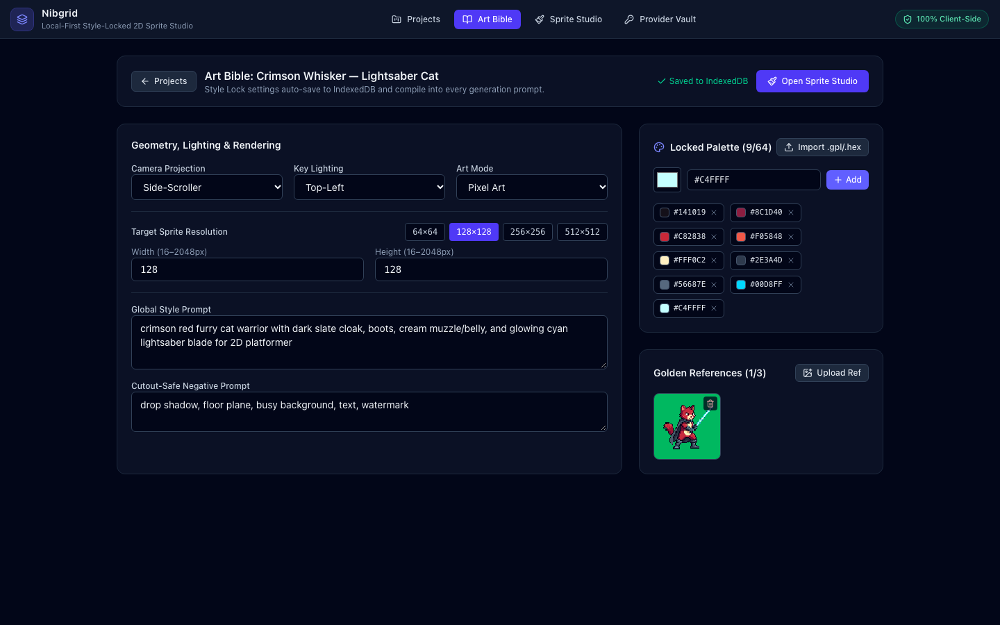

---

### 1.2 Sketch Ingestion & Web Worker Line Extraction (Screen 3)

Turn rough paper photos, mouse doodles, or existing blocking PNGs into centered, high-contrast linework inside a Dedicated Web Worker without freezing the UI.

**Click-by-Click:**

1. In the left **Sketch Ingestion** pane of **Sprite Studio**, click **Upload Sketch PNG/JPG** and select your rough drawing.
2. Click **Extract Lines & Center** so Nibgrid runs adaptive local/global thresholding and safe-margin bounding-box centering on a Web Worker.
3. Refine silhouette details directly on the stage using **Sketch Pen**, **Eraser**, and **Brush Size** (or press `Z` to undo and `Space`/`Shift+Drag` to pan).


---

### 1.3 Generate Variants & Branch in the Sprite Lineage DAG (Screen 3)

Iterate non-destructively using the **Sprite Lineage DAG** so you can branch poses, weapons, or masked inpaints from any parent without losing earlier versions.

**Click-by-Click:**

1. In the right **Generation Inspector** pane, pick your **Provider**:
   - **Built-in Deterministic Mock** (`$0.00 Local`) for zero-key prototyping and pipeline testing,
   - **Gemini Multimodal BYOK**, **Local ComfyUI**, or **Antigravity Loopback Bridge (`127.0.0.1:4188`)** configured in **Provider Vault**, or
   - **Google Antigravity IDE / Agent Handoff** to click **Copy Prompt Brief**, generate images with an IDE agent, and click **Import Agent PNG into DAG**.
2. Choose **Sketch Adherence** (`Strict` / `Balanced` / `Loose`), select **`2 Variants`**, and click **Generate 2 Variants**.
3. Click any node in the bottom **Sprite Lineage DAG** dock (or its **Fork** icon) to set it as the **Branch Parent**.
4. To surgically edit only one region (e.g., igniting a plasma slash arc), click **Inpaint Mask** in the left toolbar, paint over the blade area on the canvas, enter a **Prompt Delta**, and click **Inpaint Masked Region**.


---

### 1.4 Side-by-Side Variant & Ancestor Comparison

Evaluate silhouette consistency, weapon arcs, and lighting direction before committing a winner to post-processing.

**Click-by-Click:**

1. In the bottom **Sprite Lineage DAG** dock, click **Compare** (or click the **Compare** icon on any node card).
2. Switch **Left** and **Right** node selectors to inspect sibling variants or parent → child inpaint iterations side by side.
3. Click **Select Winner** / close the modal and click **Open Post-Process** on your chosen node.


---

### 1.5 Cutout, De-Mixel, OKLab Sel-Out, Palette Snap & Pivot Export (Screen 4A)

Clean up AI soft gradients, remove background pixels, lock pixel grid alignment, anchor the physics/feet pivot, and export reproducible PNG + `.recipe.json` bundles.

**Click-by-Click:**

1. Click **Open Post-Process** from **Sprite Studio** (or the **Post-Process** button on any DAG node).
2. Under **1. Background Cutout**, choose **Fast Color-Key (Flood Fill)** (set `Tolerance` ~`12`) or **Local AI Cutout (Worker)** (`@huggingface/transformers`), and check **Interior-RGB Color Decontamination (Defringe)** under Edge Cleanup.
3. Under **3. OKLab Palette Snap**, check **Snap to Art Bible Palette** (and optionally toggle **4×4 Ordered Bayer Dithering** for shaded transitions).
4. Under **Pixel-Art Foundry**, enable:
   - **De-Mixel Grid Snap (Auto Period)** to snap blurry upscaled pixels back onto integer mixel cells,
   - **Orphan-Pixel & Specks Cleaner** (`Max Island` + `Pepper Despeckle`) to remove stray floating dots, and
   - **Sel-Out Outline** (`Outer 1px (Sel-Out)` + `Top-Left` light angle) for perceptual dark outlines on shadow edges.
5. Enable downsampling to **`64×64`** Nearest-Neighbor and click the **`Bottom-Center`** pivot preset (`0.50, 1.00` → `(32, 64) px`).
6. Drag the vertical split handle left/right over **Checker**, **Dark**, **Light**, or **Game Green** backdrops to verify crisp edges, then click **Download ZIP** (or **Export to Local Folder** in Chromium).


**Exported `64×64` Game-Ready Platformer Sprite (`crimson-whisker-lightsaber-cat-generation-1024.png`):**


---

### 1.6 Animated GIF89a & Horizontal Spritesheet Export

Turn multi-node combat stances into a lightweight GIF preview and engine-ready horizontal strip.

**Click-by-Click:**

1. Return to **Sprite Studio** and click **Animate & GIF** in the **Sprite Lineage DAG** dock header.
2. Add your ordered DAG frames (`#1 Idle` → `#2 Mid-Charge` → `#3 Slash Arc`) using **+ Add Frame**.
3. Set **`64×64`**, **`6 FPS`**, toggle **Ping-Pong Loop** (and optional **Onion Skin**), **Auto Color-Key Cutout**, and **OKLab Palette Snap**.
4. Click **Play** to inspect motion, then click **Download GIF** and **Download Spritesheet PNG** (`192×64`).

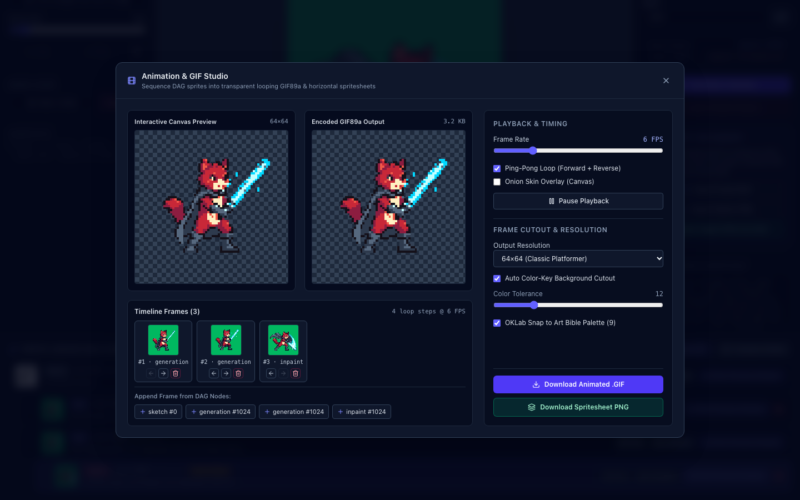

**Exported `64×64` Looping Animated `.GIF` & `192×64` Horizontal Spritesheet:**


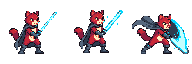

---

## Part 2 — Specialized 2D Asset Foundry Use-Case Tutorials

Once a sprite is inside **Post-Process & Export Inspector** (`Screen 4`), switch tabs along the top bar—or navigate to **Atlas Packer** (`Screen 5`), **Audio Foundry** (`Screen 6`), and **Audit** (`Screen 7`) in the global header—to unlock these specialized workflows.

### 2.1 Bake 2D Normal Maps & Audition Live Point Lighting (Screen 4B)

**When to use it:** You want top-down, dungeon crawler, or side-scroller sprites to react dynamically to torches, gunfire flashes, or day/night directional lights inside Godot, Unity, Phaser, or PixiJS without painting normal maps by hand.

**Click-by-Click:**

1. In **Post-Process & Export Inspector**, click the **`2D Lighting & Normal Map`** tab.
2. Under **Engine Y Convention**, click **Godot / OpenGL (+Y)** or **DirectX (-Y)** to match your target renderer.
3. Choose a **Bevel Profile** (`Spherical Dome`, `Pillowed`, `Chamfer`, or `Crisp Step`), then dial **Bevel Radius (EDT px)**, **Bevel Weight**, and **Surface Detail Weight** (which blends high-frequency Sobel gradients from albedo luminance).
4. Move your mouse across the center canvas to aim the real-time WebGL2 **Blinn-Phong point light** (`Click to pin`, `Alt+Wheel` to adjust light Z height), or click **`Normal Map`**, **`Bevel Height`**, and **`Split Lit | Normal`** along the top-left bar to inspect raw RGB channels.
5. Ensure **Bundle `_n.png` Normal Map in ZIP / Folder Export** is checked, then click **Download ZIP**.

**What gets exported:** Exact-matching sprite albedo PNG, aligned `_n.png` tangent-space normal map, and `normalMap` parameters recorded inside `asset.recipe.json`.


---

### 2.2 Rig Single-Sprite Idle, Sway & Recoil Loops via MLS Puppet Warp (Screen 4C)

**When to use it:** You have one great static enemy, prop, banner, or crystal sprite and need a subtle `6`-to-`8` frame idle breathe, tree wind sway, hover bob, slime squash, or hit recoil animation without redrawing frames or fighting AI consistency drift.

**Click-by-Click:**

1. Open the **`Puppet Warp Animator`** tab inside **Post-Process & Export Inspector**.
2. Click pin role buttons along the top toolbar and click directly on the sprite canvas to place your rig:
   - **`Anchor`** (blue square — roots feet/base pixels firmly to the ground),
   - **`Driver`** (amber diamond — controls chest/torso breathing or bend motion), and
   - **`Tip`** (cyan circle — drives head, weapon, cloak tip, or flame lag).
3. Right-click any placed pin to cycle its role, or drag a pin directly to test interactive Rigid / Similarity **Moving Least Squares (MLS)** mesh deformation.
4. Select a **Loop Preset** (`Idle Breathe`, `Wind Sway`, `Float Bob`, `Slime Squash`, `Hit Recoil`), set **Solver Mode** (`Rigid (Area-Lock)` or `Similarity`), **Frames** (`6`), **Edge Pad (px)** (`8`), **Amplitude**, and **Playback Speed (FPS)**.
5. Optionally enable **Ping-Pong Timeline Sequence**, **Onion Skin Ghosts (Prev/Next)**, or **Re-Lock Pixel Polish (Sel-Out + Cleanup per Frame)**.
6. Click **`Export Strip ZIP (480×80)`** to download the animated strip, frame timing JSON, and recipe—or leave it rigged to pack directly in **Screen 5 Atlas Packer**.

**What gets exported:** Seamless horizontal `<slug>_<preset>_strip.png`, frame coordinate JSON manifest, and saved `puppetAnim` pin metadata in IndexedDB.


---

### 2.3 Heal Seamless Tiles & Build 9-Slice UI Panels (Screen 4D)

**When to use it:** Either (a) AI-generated terrain textures (`stone`, `grass`, `lava`, `sci-fi grating`) show hard repeating grid lines, or (b) game UI buttons, health-bar frames, and dialog boxes need stretched middle interiors with crisp, un-stretched corner bevels.

#### Workflow A — Seamless Tile Healing (`Seamless Tile (50% Wrap)`)

**Click-by-Click:**

1. Open the **`Tile & 9-Slice`** tab and select **`Seamless Tile (50% Wrap)`**.
2. Enable **High-Pass Macro-Lighting Flatten** if one side of the texture is brighter than the other, set **Seam Mask Width (px)** and **Edge Jitter**, then click **`1. Wrap 50% & Auto-Mask for Inpaint`** to shift the image toroidally (`+⌊W/2⌋, +⌊H/2⌋`) and lock the outer corners while masking the center cross seam.
3. Click **`2. Run Seam Inpaint`** using your active provider to heal only the masked center cross.
4. Click **`3. Un-Wrap Result & Commit Node`** and inspect the live **`2×2` / `3×3` / `4×4`** tiled preview grid and **Edge Continuity Score**.

#### Workflow B — 9-Slice UI Panel Slicing (`9-Slice UI Panel`)

**Click-by-Click:**

1. Switch the mode pill at top-left to **`9-Slice UI Panel`**.
2. Click **`Auto-Detect Margins`** (or drag the cyan `L/R` and magenta `T/B` guide lines directly on the canvas with `1 px` snap; check **Lock L = R** and **Lock T = B** for symmetric frames).
3. Choose **Edge Mode** and **Center Mode** (`Stretch`, `Tile Repeat`, or `Transparent` center).
4. Inspect corner crispness across the **Live Stress-Test Matrix** (**Wide Button `240×48`**, **Tall Sidebar `72×220`**, **Square Dialog `180×180`**, and drag the bottom-right cyan handle on **Resizable `160×96`**), optionally binding an **Audio Foundry** clip to **UI Click SFX (Matrix Test)** and clicking panels to audition sound.
5. Click **`Export 9-Slice ZIP (.tres + JSON)`**.

**What gets exported:** Clean source PNG + Godot 4 `StyleBoxTexture` (`_stylebox.tres`), Phaser 3 `_nineslice_phaser.json`, PixiJS v8 `_nineslice_pixi.json`, and `asset.recipe.json`.


---

### 2.4 Create 8-Bit Indexed Palette-Swap & Multi-Faction GPU LUTs (Screen 4E)

**When to use it:** You need Red vs. Blue team units, elemental slimes, poison/frozen status skins, or rarity tiers without multiplying VRAM texture memory or re-generating sprites.

**Click-by-Click:**

1. Open the **`Palette-Swap & LUT`** tab in **Post-Process & Export Inspector**.
2. If your source image contains more than `256` unique colors, click the **`Quantize to 32 Colors`** banner button so Nibgrid packs an exact `R=G=B=index` index texture.
3. Click **`+ Add Variant`** (or a 1-click faction pill like **`+Faction Red`**, **`+Toxic Slime`**, **`+Frozen`**, **`+Shadow Cursed`**, **`+Golden Rare`**).
4. Select any clustered **OKLCH Ramp** on the left (e.g., `Neutrals / Outlines`, `Ramp 1`, `Ramp 2`) and adjust **`Hue Shift`**, **`Chroma Scale`**, **`Lightness Shift`**, and **`Temp Contrast`** while watching **Base (Row 0)**, **Variant 1**, **Variant 2**, and the **Live `N×M` LUT Texture Strip** update together.
5. Choose **Stacked `N×M` Sheet** (all variants in one texture) or **Single `N×1` per Var**, then click **`Download LUT Bundle (.zip)`**.

**What gets exported:** Linear index map (`_idx.png`), nearest-filtered palette LUT strip (`_lut.png`), Godot 4 canvas-item shader (`_lut.gdshader` with built-in damage flash uniforms), and PixiJS v8 `Filter` TypeScript helper (`_lut_pixi.ts`).

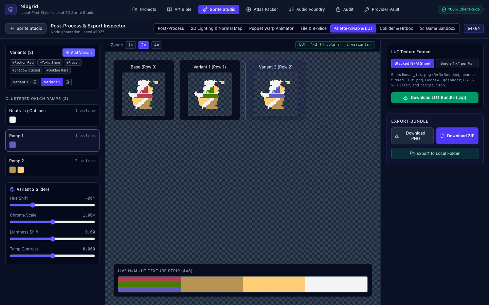

---

### 2.5 Audition Readability, Biomes & Hit-Flash at 1× Scale (Screen 4F)

**When to use it:** Sprites look crisp zoomed to `400%` on a neutral checkerboard, then vanish against dark dungeon bricks or snowy terrain in-game. Screen 4F tests true pixel scale, silhouette readability, animation motion, hitstop juice, and synchronized SFX in one place.

**Click-by-Click:**

1. Open **`Game Sandbox`** in **Post-Process & Export Inspector** (or click the **1× Preview** pill in **Sprite Studio**).
2. Click terrain **Biome Pills** along the top toolbar (**`Dark Dungeon`**, **`Urban Asphalt`**, **`Sunlit Meadow`**, **`Neutral Checker`**, **`Bright Snow`**) and read the live **Perimeter Contrast** WCAG-style HUD (`Strong` / `Moderate` / `Weak` ratio and edge separation `%`).
3. Toggle **`1×` / `2×` / `3×` / `4×`** integer scale, virtual camera resolution (`320×180 (GBA / Pixel Indie)` etc.), and diagnostic lenses (**`Normal`**, **`Value Check`** luminance grayscale, **`Silhouette`**).
4. Test combat feel by switching **`Flash White`** / **`Flash Red`** and pressing **`H`** or clicking **`Trigger Hit (H)`** (`40ms` hitstop + `110ms` hit-flash), **`F`** to flip horizontally, and **`WASD` / Arrow keys** to move.
5. In the bottom **Audio Juice** bar, switch **M12 LUT** variants or bind saved **Audio Foundry** clips to **Hit SFX (H)**, **Step / Frame SFX**, and **BGM Loop**.


---

### 2.6 Auto-Trace 2D Collision Hulls & Author Hitboxes/Hurtboxes (Screen 4G)

**When to use it:** Manually clicking physics polygon points around every character, chest, projectile, and swing arc inside Godot or Matter.js slows iteration. Nibgrid derives pivot-anchored collision hulls straight from your alpha channel.

**Click-by-Click:**

1. Open the **`Collider & Hitbox`** tab in **Post-Process & Export Inspector**.
2. Click **`8-Vertex Box2D Safe Preset`** (or choose **Primitive / Simplifier Mode** → `Convex Hull (Box2D / Godot Safe)`, `Exact Contour Polygon (RDP)`, `Tight AABB Rectangle`, or `Character Capsule (2D)` and click **`Auto-Trace Silhouette`**).
3. Click **`+ Hurtbox`** or **`+ Hitbox`** under **Semantic Physics Layers** to add damage/sensor boxes colored independently on the interactive SVG stage.
4. Drag vertices on the canvas (with `0.5 px` or `1 px` **Vertex Grid Snap**), click any white edge midpoint handle to insert a vertex, or right-click / press `Delete` to remove a vertex.
5. If your sprite has an M9 **Puppet Warp** loop, use the bottom **M9 Frames (`F0`..`F5`)** bar to activate/deactivate hitboxes strictly on active attack frames.
6. Toggle **`Godot 4 .tres`** or **`Matter.js / Phaser`** in the right **Engine Physics Preview** pane (or click **Copy**) and click **Download ZIP** to bundle `<slug>_collider.tres` and `<slug>_matter.json`.


---

### 2.7 Pack Multi-Engine Texture & Animation Atlases (Screen 5)

**When to use it:** Shipping a folder of individual sprite PNGs hurts draw calls and breaks frame timing. Screen 5 bin-packs your whole project—plus multi-frame Puppet-Warp loops—into power-of-two atlases with frame deduplication and lockstep normal maps.

**Click-by-Click:**

1. Click **`Atlas Packer`** in the top navigation bar.
2. In the left **Sprites & Loops** list, check/uncheck nodes to include, and click **`+ Add 6f Puppet Loop`** on any rigged character to pack all animation frames automatically.
3. Under **Target Game Engines** on the right, check **`Godot 4 (.tres SpriteFrames + AtlasTexture)`**, **`Phaser 3 (Multiatlas JSON)`**, and **`PixiJS v8 (JSON Hash + Animations)`**.
4. Configure **Max Atlas Page Size** (`512×512`–`4096×4096`), **Padding (px)**, **Extrude (px)** (prevents subpixel border bleeding), **Shrink to Power-of-Two (PoT)**, and optionally **Bundle Lockstep `_n.png` Normal Atlas**.
5. Inspect page occupancy (`1024×128 · 43.6% packed · 6 deduped`) and toggle **UV Bounds** or **Albedo / Normal** channel tabs, then click **`Download Atlas ZIP`**.

**What gets exported:** `atlas_0.png` (and optional `atlas_0_n.png`), `atlas_frames.tres` (Godot `SpriteFrames` with `texture_filter = 1` for pixel art), `atlas.json` (Phaser 3 Multiatlas), `atlas_pixi.json` (PixiJS v8 Hash + `animations`), and `atlas_physics.json` (combined Matter/Phaser colliders when authored).


---

### 2.8 Synthesize Procedural Foley & Google AI Game Audio (Screen 6)

**When to use it:** A game asset feels half-finished without click SFX, saber swings, footstep variations, character voice barks, or biome music loops normalized to consistent loudness.

**Click-by-Click:**

1. Click **`Audio Foundry`** in the top navigation bar and stay on the **`Presets & Google`** tab.
2. Filter presets (`ALL`, `SFX`, `UI`, `VOICE`, `MUSIC`, `AMBIENCE`) and choose a generation route:
   - **`Local Procedural Synth ($0.00)`** to shape the **3-Layer Synth Patch** (`Seed`, `Body Start Hz`, `Transient Attack Gain`, `Noise Tail Gain`) in real time with zero keys, or
   - Use your single **Gemini** key from **Provider Vault** for **Gemini Sprite-to-SFX (`gemini-to-synth`)**, **Lyria 3/3.5 (`lyria-clip` / `lyria-full`)**, or **Gemini 3.8 TTS (`gemini-tts`)**.
3. Click **`Render Local Synth ($0.00)`** / **Generate Audio** and preview playback (`Play`, `Stop`, `Loop`, **`A/B: Processed DSP`**) across the waveform and loudness badges (`In LUFS`, `Out LUFS`, `Peak dBFS`).
4. On the right **PCM Post-Processor** pane, toggle **Auto-Trim Leading/Trailing Silence**, **LUFS Loudness Normalize (-1 dBFS)** (`-14 LUFS (SFX / Impacts)` / `-16 LUFS (UI)` / `-18 LUFS (Ambience / Music)`), and **Seamless Loop Crossfade** for looping ambience/BGM.
5. Select **`1×`**, **`4×`**, or **`6×`** under **Anti-Repetition Variations** (preview variation pills `#1`–`#4` to confirm natural micro-pitch/filter spread), enter a **Clip Name**, and click **`Save to Project (4 WAV)`** (so Screen 4F Sandbox and Screen 4D 9-Slice can bind it immediately) or **`Audio ZIP`** / **`Folder`**.

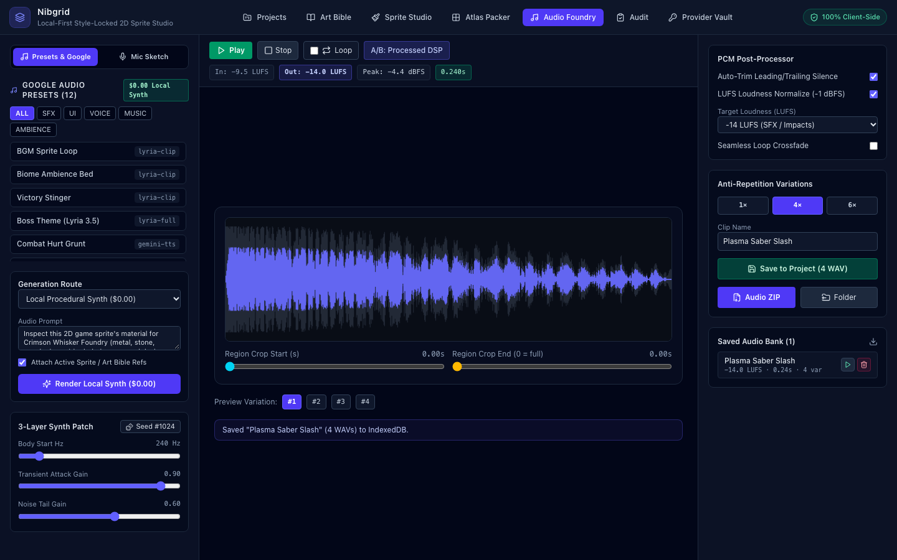

---

### 2.9 Turn Microphone Hums or WAV Sketches into Game Audio (Screen 6 · Mic Sketch)

**When to use it:** Typing "pew-woosh-chime" rarely captures the exact rhythmic timing, pitch curve, or attack envelope in your head. Hum the melody or make a mouth foley sound once and let deterministic vocal contour extraction drive synthesis or Google AI models.

**Click-by-Click:**

1. In **Audio Foundry**, switch to the **`Mic Sketch`** tab.
2. Hold **`R`** (or press **`Hold R / Press to Record Hum (10s cap)`**) to record directly from your microphone, or click **`Upload .wav Vocal Sketch`** to drop an existing `.wav` recording.
3. Inspect the **`VOCAL PITCH & FOLEY RIBBON`** canvas: cyan `f0(t)` pitch tracking, white RMS loudness bars, amber unvoiced breath/noise regions (`"shhh"/"ksh"`), plus detected `BPM` and dominant musical key.
4. Click any of the 6 **Quick Intent Presets**:
   - **$0.00 Local Contour Synth:** **`Laser / Pew ($0)`**, **`Engine Rev ($0)`**, **`Heavy Impact ($0)`**, **`Chiptune Hum ($0)`**
   - **Single-Key Multimodal Routing:** Choose `Local Contour Synth ($0.00)`, `Gemini Audio → Timbre Patch (~$0.001)`, `Hum → Lyria 3 Full Clip (~$0.04)`, or `Vocal Cadence → Gemini TTS (~$0.005)`, then dial **Octave Shift**, **Pitch Smooth (ms)**, **Scale Quantize**, **FM Depth**, **Unvoiced Noise Gain**, and **Bit Depth**.
5. Toggle **`A/B: Transformed Sound`** vs raw recording, select **`1×` / `4×` / `6×`** variations, and click **`Save to Project`** or **`Audio ZIP`** (exporting complete `audioSketch` BPM/key/patch provenance inside `.audio.recipe.json`).


---

### 2.10 Audit Project Compliance & Run 1-Click $0.00 Batch Fixes (Screen 7)

**When to use it:** Mid-production you tweak your Art Bible palette, switch target level biomes, or notice older sprites lack collision hulls and audio clips clip (`-2.3 LUFS`). Screen 7 scans every asset in IndexedDB and brings the project back to green in one atomic batch at `$0.00` AI cost.

**Click-by-Click:**

1. Click **`Audit`** in the top navigation bar to open **Project-Wide Audit Matrix**.
2. Inspect the **`0–100` Readiness Score**, filter pills (**`ALL`**, **`FAILING`**, **`WARNINGS+FAILS`**, **`STALE`**, **`SPRITES`**, **`AUDIO`**), and switch **`Target Biome`** (`Dark Dungeon`, `Bright Snow`, etc.) to test `1× Contrast` across every sprite simultaneously.
3. Click any failing cell pill (e.g., `Missing` collider or `88.7% drift` palette) to jump straight into the exact inspector tab for that asset, **or** click **`Fix All Stale & Failing`** at top right.
4. In the right **Batch Recipe Runner** drawer, verify which deterministic operations are checked (**Sync Art Bible Palette**, **Re-run Pixel Foundry**, **Auto-Trace Missing Colliders**, **Re-bake Palette LUTs**, **Normalize Audio LUFS**), choose **Update In-Place** or **Fork Child Nodes**, and inspect the live **Dry-Run Batch Plan** (`$0.00 local compute`).
5. Click **`Run Batch`** to execute sequentially inside atomic Dexie transactions (with mid-run **Cancel** support and an immediate **`Undo Batch`** button to revert the entire session cleanly).

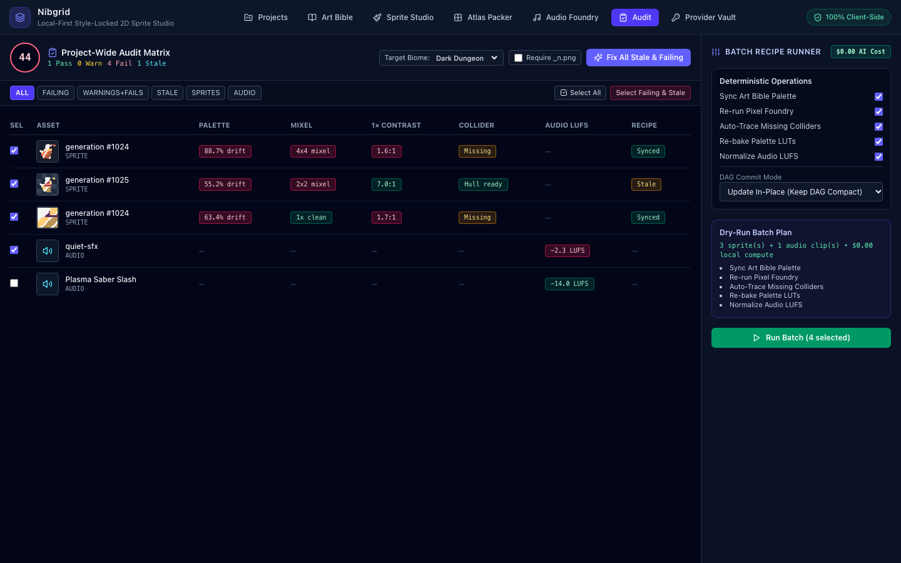

---

### 2.11 Pair the Local Antigravity Loopback Bridge (127.0.0.1:4188)

**When to use it:** You want the hosted GitHub Pages PWA (`https://franekjemiolo.github.io/nibgrid/`) to invoke your local Antigravity IDE models with stateful `interaction_id` chaining and automated Art Bible critique—without exposing keys or running a cloud backend.

**Click-by-Click:**

1. Start the loopback bridge locally from the repository root:
   ```bash
   uv run .agents/skills/nibgrid/scripts/nibgrid_bridge.py
   # Or offline smoke test mode:
   uv run .agents/skills/nibgrid/scripts/nibgrid_bridge.py --mock
   ```
2. Copy the ephemeral `nbg_...` bearer token printed in your terminal.
3. In Nibgrid's top header, click **`Provider Vault`**, choose **Adapter Type** → **`Antigravity Loopback Bridge (127.0.0.1:4188)`**, paste the `nbg_...` token into **Ephemeral Session Token**, and click **Save Provider**.
4. Select the saved bridge provider in **Sprite Studio** to unlock automatic **Art Bible Critique (`score/100` + `Apply Suggested Delta`)** and stateful `interaction_id` child chaining.

---

### 2.12 Slice 2×2 / 1×4 Turnaround Sheets into Linked Views (Screen 4H)

**When to use it:** Generating `south`, `east`, `north`, and `west` directions in four separate AI calls causes outfit and proportion drift. Sheet Mode generates all four orthographic views in one pass and extracts uniformly scaled, pivot-locked directional sprites cleanly.

**Click-by-Click:**

1. In **Sprite Studio** (`Screen 3`), toggle Sheet Mode to **`2x2`** or **`1x4`** in **Generation Inspector** and click **Generate**.
2. Click the generated turnaround node card and click **Open Post-Process**—Nibgrid opens **`Turnaround Slicer`** (`Screen 4H`) automatically with 4-connected BFS view detection offloaded to a Web Worker.
3. Adjust **Uniform Padding**, **Min Speck Pixels (BFS Threshold)**, **Normalize Height (Median Lock)**, **Mirror East → West**, and **Slot Direction Mapping** (`SOUTH`, `EAST`, `NORTH`, `WEST`) as needed.
4. Switch between **`Onion-Skin Stack`** (35% layered silhouettes over the bottom-center pivot crosshair) and **`Turntable`** playback to confirm foot-ground alignment across all 4 angles.
5. Click **`Commit 4 Linked Views`** to store all 4 directional `SpriteNode`s atomically under a shared `directionGroupId`, ready to drop straight into **Screen 5 Atlas Packer**.

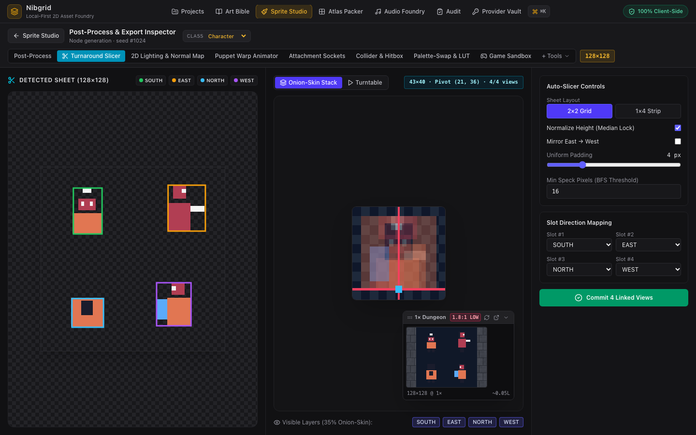

---

### 2.13 Navigate Fast with Contextual Tabs, 1× PiP, Wipe & Command Palette (Studio UX)

**When to use it:** Keep your canvas large and unobstructed while switching seamlessly between character, prop, tile, UI-panel, and VFX tools across screens.

**Click-by-Click:**

1. Use the **`Class`** dropdown (`Character`, `Prop`, `Tile / Terrain`, `UI Panel`, `VFX`) in Screen 4's header to tailor primary tabs automatically (for example, `UI Panel` streamlines to 3 primary tabs while tucking secondary tools into **`+ Tools`**).
2. Drag **`ScrubInput`** number bars horizontally for fast coarse adjustments (`Shift+Drag` for `0.1×` precision, double-click to type an exact value), and use the floating **`CanvasHud`** pill for zoom, pixel grid, backdrops, and wipe toggles.
3. Drag the **Before/After Wipe** divider across **Raw/Processed** (`Screen 4A`), **Flat Albedo/Lit Normal** (`Screen 4B`), and **Base/LUT** (`Screen 4E`) previews (press `\` to toggle or double-click to reset to `50%`).
4. Keep an eye on the draggable **`1×` PiP Biome Contrast** card in the bottom-right corner (`P` toggles collapse) to verify sprite readability over dungeon, meadow, or snow backdrops at native scale without leaving your active tool.
5. Press **`Cmd/Ctrl+K`** (or click **`⌘K`**) anywhere in Nibgrid to jump directly to any screen, Inspector tool, sprite node, or audio clip—or drop `.png`/`.webp`/`.wav` files onto any window edge to open the **Universal Drop Router**.

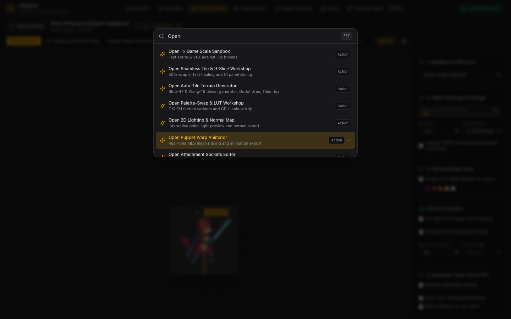

---

### 2.14 Paint & Export Blob-47 / Wang-16 Auto-Tile Terrain Sets (Screen 4I)

**When to use it:** Painting cliffs, mossy floors, roads, and dungeon platforms manually requires dozens of inner and outer corner tiles. Nibgrid generates canonical 47-tile Blob (`8×6`) or 16-tile Wang (`4×4`) sheets directly from any square terrain fill texture and lets you paint-test transitions live.

**Click-by-Click:**

1. Open Screen 4 on a square terrain texture (set **`Class` → `Tile / Terrain`**, or pick **`Auto-Tile`** from `+ Tools`).
2. Under **Auto-Tile Rule Set**, select **`Blob-47 (8×6)`** or **`Wang-16 (4×4)`**.
3. Pick an **Edge Treatment Style** (`Organic Overhang (Deterministic Jitter)`, `Crisp Bevel`, or `Pixel Outline`), optionally pick an **Underlay Terrain Sprite** from your project (e.g., dirt under grass), and dial **SDF Transition Geometry** (`Border Inset`, `Corner Radius`, `Organic Jitter`, `Edge Tint`, `Seed`).
4. Left-click/drag directly across **`Live 12×8 Paint Map`** (or click **`Load Sample Map`**) to test inner corners, corridors, and islands in real time, and toggle **`Full Packed Sheet`** to inspect the complete `8×6` or `4×4` texture.
5. Click **`Save to Project`** and **`Download Terrain Bundle (.zip)`** to export the packed PNG, Godot 4 `TileSet` `<slug>_tileset.tres`, Tiled `<slug>.tsx` (`<wangsets>`), and `<slug>.recipe.json`.

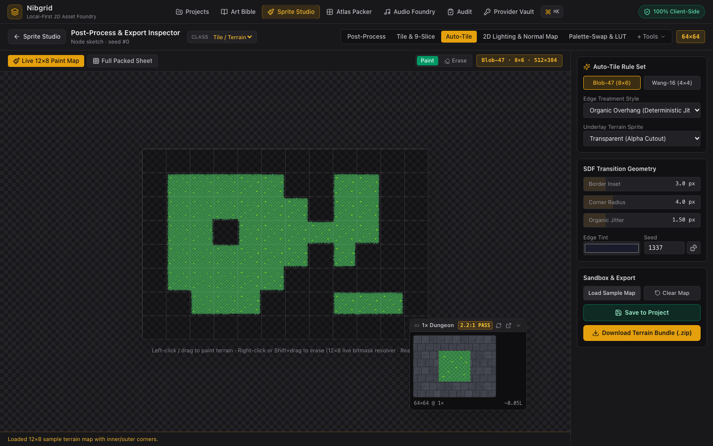

---

### 2.15 Bind Mesh-Tracked Attachment Sockets onto Sprites & Rigs (Screen 4J)

**When to use it:** Spawning bullets at a gun barrel, attaching a held torch or sword, or anchoring thruster particles shouldn't break the moment a character breathes or bends. Named sockets bind once to M9 Moving Least Squares triangles via barycentric coordinates and follow every frame's position and angle.

**Click-by-Click:**

1. Open **`Attachment Sockets`** in Screen 4 (`Character`, `Prop`, `VFX`, or `+ Tools`).
2. Click **Quick Presets** (`+ hand_r`, `+ hand_l`, `+ muzzle`, `+ exhaust`, `+ head`, `+ center`) or enter a **Custom Socket ID** (auto-sanitized to `^[a-z0-9_]+$`) and click **Add**.
3. Drag each color-coded crosshair directly on the rest-pose stage relative to the amber Pivot crosshair, and scrub **Base Angle** (in degrees) on the left pane (press `Delete`/`Backspace` outside text inputs to remove the selected socket).
4. If your sprite has **Puppet Warp Animator** (`Screen 4C`) pins, scrub the bottom **Frame Slider** to inspect deformed `(x, y)` coordinates and tangent rotations tracked across every animation frame.
5. Preview **`Godot 4`** (`Marker2D`), **`Phaser 3`** JSON, or **`PixiJS`** JSON on the right, click **`Save Sockets to Project`**, and click **`Download Sprite + Sockets ZIP`** (any sprite ZIP export with sockets automatically bundles `<slug>_sockets.json` and records `sockets[]` in `<slug>.recipe.json`).

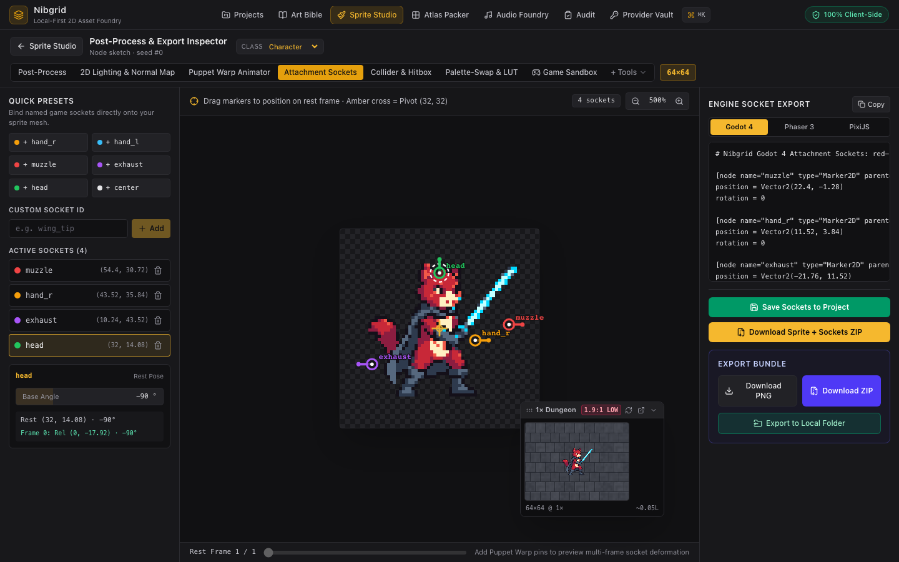

---

### 2.16 Bake Procedural 2D VFX Flipbooks & Particle Sheets (Screen 4K)

**When to use it:** Generating multi-frame spark bursts, dust clouds, rising smoke, impact rings, or burning pixel dissolves frame-by-frame with AI leads to popping centers and uneven frame sizes. Screen 4K synthesizes deterministic `cols × rows` sheets off the main thread in a Web Worker.

**Click-by-Click:**

1. Set **`Class` → `VFX`** (or open **`VFX Baker`** from `+ Tools` / `Cmd+K`).
2. Pick a **VFX Archetype** (**`Sparks`**, **`Dust Puff`**, **`Smoke`**, **`Hit Ring`**, or **`Noise Dissolve`**), **Grid Layout** (`4×4`, `8×2`, `4×2`), and **Cell Size** (`32px`, `64px`).
3. Dial **`Seed`**, **`Spread`**, **`Turbulence`**, and **`Playback FPS`** with `ScrubInput`, pick **Core** / **Outer** colors from your **Art Bible** swatches (toggle **`Snap to Art Bible Palette`** to quantize every frame cleanly, or **`Use Active Sprite (Dissolve)`** to erode the active sprite silhouette).
4. Switch between **`Live Flipbook`** (`Play`/`Pause`, **`Ping-Pong`**, `Checker`/`Dark`/`Light` stage) and **`Full Sheet`** (`256×256` grid inspection).
5. Inspect **`Godot .tres`**, **`Godot .tscn`**, or **`PixiJS JSON`**, click **`Save VFX to Project`**, and click **`Download VFX ZIP`** to export `<slug>_vfx_sheet.png`, Godot `CanvasItemMaterial` `.tres` + `GPUParticles2D` `.tscn`, `<slug>_vfx_pixi.json`, and `<slug>.recipe.json`.

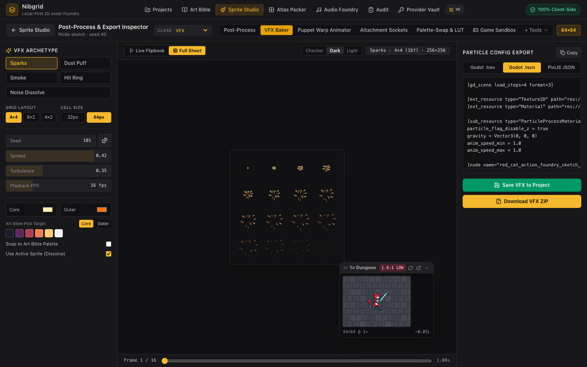

---

### 2.17 Compose Seamless Parallax Backgrounds & Depth Tinting (Screen 4L)

**When to use it:** Side-scrollers look flat when background hills fight your foreground character for contrast or show hard vertical seams every few hundred pixels. Screen 4L generates style-matched 3–4 band depth stacks (via Gemini BYOK, Antigravity Bridge, or `$0.00` Offline Mock) or imports your own PNGs, strips `#FF00FF` chroma backgrounds, heals horizontal wrap seams in pure TS/Web Worker threads, applies atmospheric aerial haze toward the horizon, and previews 60 FPS scroll ratios beside a `1×` foreground character check.

**Click-by-Click:**

1. Open **`Parallax BG`** in Screen 4 (primary tab under **`Class` → `Tile / Terrain`**, or inside **`+ Tools`** / `Cmd/Ctrl+K`).
2. In the right **Generate Matched Stack (AI)** panel, pick your **Provider** (`Offline Mock` `$0.00`, **Gemini Multimodal BYOK**, or **Antigravity Loopback Bridge**), click a **Biome Preset** (**`Masovian Dusk Forest`**, **`Cyberpunk Rooftops`**, **`Volcanic Cavern`**, or **`Pixel Meadow`**), select **`3 Bands`** or **`4 Bands`**, keep **`Master Ref`** checked for cross-layer style anchoring, and click **`Generate Matched Stack`**.
3. Click **`↻`** on any individual row in **Bands (Back → Front)** to surgically reroll only that depth plane, or click **`+ Current Sprite`** / **`Upload PNG`** to mix custom layers (reorder with ↑ / ↓ or toggle visibility).
4. Select any band to dial **`Scroll Ratio`**, **`Depth Haze`**, **`Seam Blend Width`**, and **`Y-Offset`** with `ScrubInput`, tune **`Contrast Dampening`** & **`Sky Top` / `Horizon Scatter`** colors (or click any **Art Bible** swatch), and toggle **`1× Sprite Contrast`** to test foreground silhouette separation while scrolling.
5. Inspect the live **`Godot 4 Parallax2D (.tscn)`** or **`Phaser TileSprite / PixiJS JSON`** tab, click **`Save Parallax Scene`** to store band blobs in IndexedDB, and click **`Download Parallax Bundle (.zip)`** for wrap-seamless band PNGs, `.tscn`, `.json`, and `<slug>.recipe.json`.

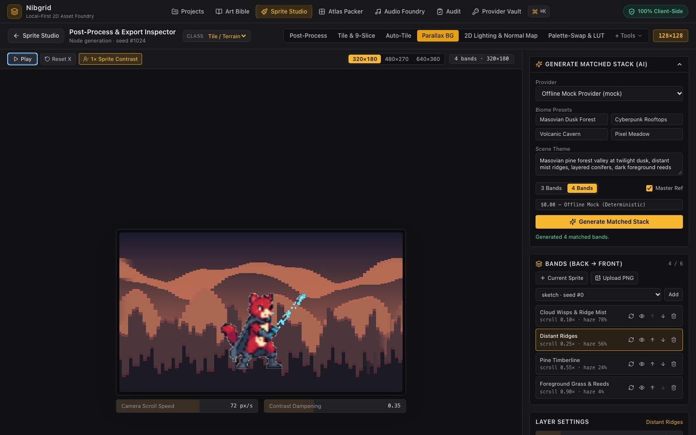

---

### 2.18 Export Palette-Locked Bitmap Fonts & Damage Numerals (Screen 4M)

**When to use it:** System fonts immediately clash with stylized 2D sprites and pixel-art HUDs—especially on floating combat numbers (`-42`, `CRIT 128!`) and status popups. Screen 4M deterministically styles either built-in crisp pixel glyphs or uploaded `.ttf`/`.otf`/`.woff2` faces through your active **Art Bible** palette, luminance-aware OKLab Sel-Out outlines, and hard-pixel drop shadows before packing a Power-of-Two sheet plus AngelCode `.fnt` and `.xml` descriptors.

**Click-by-Click:**

1. Open **`Bitmap Font`** in Screen 4 (primary tab under **`Class` → `UI Panel`**, or inside **`+ Tools`** / `Cmd/Ctrl+K`).
2. Under **Glyph Source**, pick **`5×7 Pixel`** for built-in pure-TS pixel bitmaps or **`.TTF / System`** to choose a system font / upload a local font file and dial **`Raster Size`**, then pick **`Damage (23)`**, **`HUD Upper`**, **`ASCII (95)`**, or type a custom charset.
3. Dial **`Integer Scale`** (`1×`–`4×`), choose **`OKLab Sel-Out Outline`** (`None` / `4-Way` / `8-Way`) + **`Sel-Out Darken`**, set **`Shadow X`** / **`Shadow Y`**, **`Spacing`**, **`Padding`**, click **`Top`** / **`Bottom`** gradient stops (or click **Art Bible** swatches), and keep **`Snap Fill to Art Bible Palette`** checked.
4. Audition readability over game biomes in **`Live Combat`**, edit **`Preview String`**, click **`Spawn Crit Pop`** to preview animated damage arcs, or switch to **`Packed Atlas`** to inspect the Power-of-Two sheet.
5. Inspect **`Godot 4 (.fnt)`** or **`Phaser / Pixi (.xml)`**, click **`Save Font to Project`** to store the recipe in IndexedDB, and click **`Download BMFont ZIP`** for `<slug>.png`, `<slug>.fnt`, `<slug>.xml`, and `<slug>.recipe.json`.

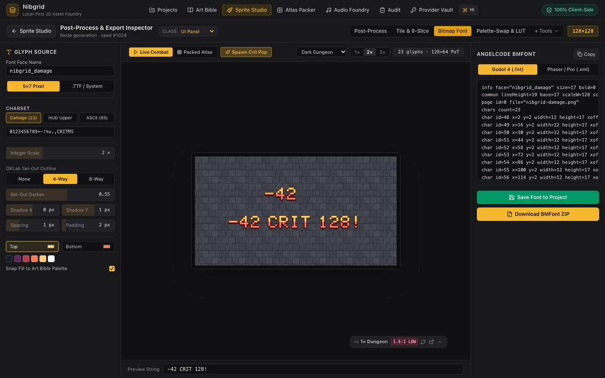

---

## Part 3 — Engine Drop-In Integration Examples

### Godot 4 (`4.2+`)

Nibgrid exports Godot-native `.tres` resources (`AtlasTexture` / `SpriteFrames`, `StyleBoxTexture`, `ConvexPolygonShape2D` / `CapsuleShape2D`) and `canvas_item` `.gdshader` files with nearest filtering baked in:

1. **Animated SpriteFrames & Physics Shape (`Atlas Packer` / `Collider` exports):**
   - Drop `atlas_0.png`, `atlas_0_n.png`, `atlas_frames.tres`, and `<slug>_collider.tres` into `res://assets/`.
   - Assign `atlas_frames.tres` directly to an `AnimatedSprite2D.sprite_frames` slot, and assign `<slug>_collider.tres` to your `CollisionShape2D.shape`.
2. **Normal-Mapped Sprite via `CanvasTexture`:**
   - Assign `sprite.png` to `CanvasTexture.diffuse_texture`, `sprite_n.png` to `CanvasTexture.normal_texture`, and set `texture_filter = TEXTURE_FILTER_NEAREST` on the `Sprite2D` node.
3. **Runtime Palette-Swap Shader (`<slug>_lut.gdshader`):**
   ```gdscript
   # Attach exported <slug>_lut.gdshader to Sprite2D Material -> ShaderMaterial
   # Texture = <slug>_idx.png (Filter: Nearest), lut_tex = <slug>_lut.png
   @onready var mat := $Sprite2D.material as ShaderMaterial

   func set_faction(variant_idx: int) -> void:
       mat.set_shader_parameter("variant_index", variant_idx)

   func trigger_hit_flash() -> void:
       mat.set_shader_parameter("flash_amount", 1.0)
       create_tween().tween_property(mat, "shader_parameter/flash_amount", 0.0, 0.11)
   ```
4. **9-Slice UI Panel (`<slug>_stylebox.tres`):**
   - Drop `<slug>.png` and `<slug>_stylebox.tres` into the same `res://ui/` folder and assign `<slug>_stylebox.tres` directly to `PanelContainer` or `Button` → `Theme Overrides` → `Styles` → `Panel` / `Normal`.
5. **Blob-47 / Wang-16 Terrain (`<slug>_tileset.tres`), `Marker2D` Sockets, `GPUParticles2D` VFX & `Parallax2D` Vistas:**
   - Drop `<slug>_autotile_blob-47.png` + `<slug>_tileset.tres` into `TileMapLayer.tile_set` to paint terrain transitions immediately with pre-bound `terrains_peering_bit/*` rules.
   - Paste exported `[node name="..." type="Marker2D" parent="."]` blocks under your centered `Sprite2D` / `AnimatedSprite2D`, load `<slug>_vfx_godot.tscn` + `<slug>_vfx_godot.tres` for flipbook `GPUParticles2D` bursts, or open `<slug>_parallax.tscn` (Godot 4.3+ `Parallax2D` nodes with baked `scroll_scale`, `repeat_size`, and `texture_filter = 1`) alongside your exported layer PNGs.
6. **Bitmap Fonts & Floating Damage Numerals (`<slug>.fnt` + `<slug>.png`):**
   - Drop `<slug>.fnt` and `<slug>.png` into `res://fonts/`. Godot 4 imports `<slug>.fnt` natively as a `FontFile` (set `Antialiasing = None` and `Texture Filter = Nearest`), ready to assign directly to `Label` / `RichTextLabel` → `Theme Overrides` → `Fonts`.

### Phaser 3 (`3.60+`) + Matter.js

```ts
// 1. Preload packed Multiatlas, combined Matter PhysicsEditor JSON & Attachment Sockets
this.load.multiatlas('hero_atlas', 'assets/atlas.json', 'assets');
this.load.json('hero_physics', 'assets/atlas_physics.json');
this.load.json('hero_sockets', 'assets/cat-warrior_sockets.json');
this.load.tilemapTiledJSON('level_tileset', 'assets/moss-turf.tsx'); // Tiled auto-tile XML

// 2. Spawn physics-backed sprite and sync a muzzle attachment per animation frame
const shapes = this.cache.json.get('hero_physics');
const sockets = this.cache.json.get('hero_sockets').sockets;
const hero = this.matter.add.sprite(240, 180, 'hero_atlas', 'cat_warrior_0', {
  shape: shapes.cat_warrior,
});
const frame0Muzzle = sockets.muzzle.frames[0];
const muzzleWorldX = hero.x + frame0Muzzle.x;
const muzzleWorldY = hero.y + frame0Muzzle.y;

// 3. Spawn horizontal-wrapping TileSprite bands from <slug>_parallax.json
const parallax = await (await fetch('assets/dusk-vista_parallax.json')).json();
const bgSprites = parallax.layers.map(
  (layer: {
    filename: string;
    width: number;
    height: number;
    yOffsetPx: number;
    phaser: { scrollFactorX: number };
  }) =>
    this.add
      .tileSprite(0, layer.yOffsetPx, this.scale.width, layer.height, layer.filename)
      .setOrigin(0, 0)
      .setScrollFactor(layer.phaser.scrollFactorX, 0),
);

// 4. Load AngelCode XML bitmap font for floating damage numerals
this.load.bitmapFont('crit_nums', 'assets/nibgrid-damage.png', 'assets/nibgrid-damage.xml');
this.add.bitmapText(hero.x, hero.y - 24, 'crit_nums', 'CRIT 128!').setOrigin(0.5);
```

### PixiJS v8

```ts
import { Assets, AnimatedSprite, BitmapText, NineSliceSprite, Texture, Rectangle } from 'pixi.js';
import { createPaletteSwapFilter } from './cat_warrior_lut_pixi';

// 1. Load packed PixiJS v8 JSON Hash atlas + animations
const sheet = await Assets.load('assets/atlas_pixi.json');
const runner = new AnimatedSprite(sheet.animations.idle_breathe);
runner.animationSpeed = 8 / 60;
runner.play();

// 2. Apply exported GPU Palette-Swap LUT filter (enforces Nearest filtering automatically)
const lutTex = await Assets.load('assets/cat_warrior_lut.png');
runner.filters = [createPaletteSwapFilter(lutTex, 1)]; // switch to Variant row 1

// 3. Track named attachment socket (`<slug>_sockets.json`) and trigger VFX flipbook (`_vfx_pixi.json`)
const socketSpec = await (await fetch('assets/cat-warrior_sockets.json')).json();
const vfxSpec = await (await fetch('assets/spark-burst_vfx_pixi.json')).json();
const vfxBase = await Assets.load(vfxSpec.texture);
const vfxFrames = vfxSpec.frames.map(
  (f: { x: number; y: number; w: number; h: number }) =>
    new Texture({ source: vfxBase.source, frame: new Rectangle(f.x, f.y, f.w, f.h) }),
);
const burst = new AnimatedSprite(vfxFrames);
burst.blendMode = vfxSpec.blendMode; // 'add' for Sparks / Hit Rings, 'normal' for Smoke / Dust
burst.animationSpeed = vfxSpec.fps / 60;
const handFrame = socketSpec.sockets.hand_r.frames[runner.currentFrame];
burst.position.set(runner.x + handFrame.x, runner.y + handFrame.y);
burst.rotation = handFrame.rotationRad;
burst.loop = false;
burst.play();

// 4. Responsive 9-Slice UI frame from <slug>_nineslice_pixi.json margins
const sliceMeta = await (await fetch('assets/panel_nineslice_pixi.json')).json();
const panel = new NineSliceSprite({
  texture: await Assets.load('assets/panel.png'),
  leftWidth: sliceMeta.leftWidth,
  topHeight: sliceMeta.topHeight,
  rightWidth: sliceMeta.rightWidth,
  bottomHeight: sliceMeta.bottomHeight,
  width: 320,
  height: 120,
});

// 5. Render pixel-crisp AngelCode bitmap font (`<slug>.fnt` or `.xml`)
await Assets.load('assets/nibgrid-damage.fnt');
const pop = new BitmapText({
  text: 'CRIT 128!',
  style: { fontFamily: 'nibgrid_damage' },
});
```

---

## Architecture Summary

- **100% Client-Side & Zero-Cost Static PWA:** Runs entirely in the browser with no backend server, deployable cleanly to GitHub Pages under a configurable base path (`VITE_BASE_PATH=/nibgrid/`).
- **Art Bible Style Lock & Branching DAG Studio:** Persists projects, color palettes (`.gpl` / `.hex`), Golden Style References, sketch/inpaint masks, and non-destructive sprite lineage DAG nodes in local IndexedDB (`Dexie.js`) validated by `Zod`.
- **Google Antigravity IDE / Agent Integration & Loopback Bridge:** Select **Google Antigravity IDE / Agent Handoff** (`antigravity-agent`) for Markdown briefs and PNG DAG import, or pair the GitHub Pages PWA with the local **Antigravity Loopback Bridge** (`127.0.0.1:4188`, `antigravity-bridge`, [.agents/skills/nibgrid/SKILL.md](.agents/skills/nibgrid/SKILL.md), `uv run .agents/skills/nibgrid/scripts/nibgrid_bridge.py`) supporting stateful `interaction_id` chaining and Art Bible critique feedback.
- **Worker-Isolated Image Processing & Pixel-Art Foundry:** Sketch normalization, Chroma-Key cutout, De-Mixel grid detection & integer snapping (`demixel.ts`), 4-connected orphan-pixel & pepper despeckling (`orphanCleaner.ts`), OKLab light-aware `outer`/`inner` Sel-Out outlining (`selOut.ts`), OKLab palette quantization + 4×4 Bayer dithering, and `asset.recipe.json` + `.zip` packaging execute purely on-device.
- **WebGL2 2D Normal Maps & MLS Puppet-Warp Animator (Screens 4B & 4C):** Bake Godot/OpenGL (`+Y`) or DirectX (`-Y`) `_n.png` normal maps using exact Felzenszwalb–Huttenlocher EDT bevels with live cursor Blinn-Phong point lighting (`NormalMapPreview.tsx`), and rig control pins with Rigid/Similarity Moving Least Squares deformation (`mlsWarp.ts`, `PuppetWarpEditor.tsx`) to bake seamless idle, sway, recoil, and squash strips.
- **Seamless Tile, 9-Slice UI Panel & Palette-Swap LUT Workshops (Screens 4D & 4E):** Heal tiling textures via toroidal 50% wrap-offset, wavy center cross-seam auto-masking, and DAG inpainting with `gl.REPEAT` toroidal normal maps (`seamlessTile.ts`); slice UI frames with pixel-exact corners, auto-detected margins, live stress-test previews, and Godot `StyleBoxTexture` `.tres` / Phaser 3 / PixiJS v8 exports (`nineSlice.ts`, `nineSliceExporters.ts`); and pack lossless 8-bit indexed sprites with OKLCH palette-swap 1D/stacked LUTs + `.gdshader` / PixiJS v8 filters (`paletteLut.ts`, `lutShaders.ts`).
- **1× Game Scale Sandbox (Screen 4F):** Audition sprites, M9 Puppet-Warp loops, and M12 Palette-Swap LUT variants at exact integer `1×`–`4×` game scale over scrolling procedural biomes (`sandboxBiomes.ts`) with pure Canvas2D zero-allocation rendering (`sandboxEngine.ts`), live Rec.709 perimeter contrast telemetry (`sandboxContrast.ts`), `Normal` / `Value Check` / `Silhouette` lenses, and `40ms` hitstop + `110ms` hit-flash combat juice.
- **2D Collision Hulls, Hitbox/Hurtbox Editor & Physics Exporters (Screen 4G):** Trace sprite alpha channels via zero-padded integer half-pixel Marching Squares (`collisionHull.ts`) with closed-loop Ramer-Douglas-Peucker simplification, Andrew's Monotone Chain convex hulls, 8-vertex Box2D caps, and tight capsules anchored to exact `pivotPx`; edit semantic **Collider** / **Hurtbox** / **Hitbox** polygons interactively across M9 animation frames (`ColliderEditor.tsx`); and bundle Godot 4 `.tres` (`ConvexPolygonShape2D` / `CapsuleShape2D`), Phaser 3 / Matter.js PhysicsEditor JSON (`colliderExporters.ts`), and combined `atlas_physics.json` into sprite and atlas ZIP exports.
- **Google-First Client-Side Audio Foundry & Hum-to-Sound (Screen 6):** Synthesize deterministic 3-layer procedural foley (`proceduralSynth.ts`), record up to `10s` of raw mic hums via inline `Blob`-URL `AudioWorklet` (`micRecorder.ts`, `vocalAnalyzer.ts`, `contourSynth.ts`), or orchestrate Lyria 3/3.5 (`lyria-clip`/`lyria-full`), Gemini 3.8 TTS (`gemini-tts`), Gemini Sprite-to-SFX (`gemini-to-synth`), and Hum-to-Timbre/Lyria/TTS (`humToSoundProvider.ts`) via Provider Vault's single Gemini key; run Worker-isolated silence trim, LUFS normalization, seamless loop crossfade, and 1/4/6 variation batching; export WAV16 + `.audio.recipe.json` ZIPs; and bind clips into Screen 4F Sandbox and Screen 4D 9-Slice panels.
- **Animated GIF89a, Horizontal Spritesheet & Multi-Engine Atlas Packer (Screen 5):** Sequence DAG sprites into transparent GIF89a animations (`gif.ts`), or pack sprites, linked M18 directional groups, and Puppet-Warp loops via BSSF MaxRects (`maxRects.ts`, `AtlasWorkshop.tsx`) with frame deduplication, edge extrusion, lockstep `_n.png` normal atlases, and native Godot 4 `.tres`, Phaser 3 Multiatlas JSON, and PixiJS v8 exports.
- **2×2 / 1×4 Orthographic Turnaround Sheet & Connected-Component Auto-Slicer (Screen 4H):** Generate all 4 cardinal views (`south`, `east`, `north`, `west`) in one single-pass Screen 3 Sheet Mode call (`promptCompiler.ts`), extract & merge detached accessories off-thread via 4-connected BFS (`turnaroundSlicer.ts`, `postprocess.worker.ts`), normalize view height, preview 35% Onion-Skin & Turntable alignment over shared `pivotPx` (`TurnaroundSlicer.tsx`) with optional East→West mirror, and atomically commit 4 linked `directionGroupId` nodes (`turnaroundCommit.ts`).
- **Project-Wide Asset Audit Matrix & 1-Click Deterministic Batch Recipe Runner (Screen 7):** Audit every sprite and audio asset in IndexedDB (`projectAudit.ts`, `AuditMatrixView.tsx`) against Art Bible palette lock, 1× mixel density, dynamic target-biome contrast, M16 collider coverage, M14 category LUFS loudness + leading silence, and `recipeArtBibleHash` freshness; compute a `0–100` Readiness Score; and run `$0.00 local compute` deterministic batch fixes (`batchRunner.ts`, `BatchRunnerDrawer.tsx`) with dry-run previews, atomic Dexie transactions, mid-run cancellation, and 1-click session rollback + orphan blob garbage collection.
- **Studio UX Polish, Floating HUD, Contextual Workspaces & `Cmd/Ctrl+K` Command Palette:** Color-accurate achromatic studio chrome (`tokens.css`), `ScrubInput` precision drag/inline controls (`scrubMath.ts`, `ScrubInput.tsx`), bottom-center floating `CanvasHud.tsx` (`70%+` viewport canvas), asset-type-aware inspector tabs with `+ Tools` overflow (`workspaceTabs.ts`), always-on zero-WebGL2 `1×` PiP Biome Contrast preview (`PipBiomePreview.tsx`), universal `BeforeAfterWipe.tsx` (`Raw`/`Processed`, `Flat Albedo`/`Lit Normal`, `Base`/`LUT`), fuzzy `Cmd/Ctrl+K` palette (`commandRegistry.ts`, `CommandPalette.tsx`), and external `UniversalDropOverlay.tsx`.
- **Blob-47 & Wang-16 Auto-Tile Terrain Generator (Screen 4I):** Strip redundant diagonals (`gateBlobMask()`, `autoTile.ts`) and compose `8×6` (`blob-47`) or `4×4` (`wang-16`) SDF terrain sheets in Worker threads over optional underlay sprites, test live transitions on an interactive `12×8` paint-test canvas (`AutoTileWorkshop.tsx`), and export Godot 4 `TileSet` `.tres`, Tiled `.tsx` (`<wangsets>`), and `.recipe.json` ZIP bundles (`autoTileExporters.ts`).
- **Named Attachment Sockets & Per-Frame Mesh Tracking (Screen 4J):** Bind named sockets (`hand_r`, `hand_l`, `muzzle`, `exhaust`, `head`, `center`, or custom IDs) via barycentric triangle weights onto M9 Moving Least Squares meshes (`attachmentSockets.ts`), drag markers & scrub frame deformation in the zero-WebGL2 Canvas2D/SVG workshop (`SocketEditor.tsx`), preview Godot 4 `Marker2D` `.tscn` / Phaser 3 / PixiJS snippets (`socketExporters.ts`), and bundle `<slug>_sockets.json` + `sockets[]` `.recipe.json` manifests inside sprite ZIPs (`zipPackager.ts`).
- **2D VFX Flipbook & Particle Sheet Baker (Screen 4K):** Synthesize deterministic `4×4`, `8×2`, or `4×2` spark bursts, dust puffs, smoke plumes, shockwave hit rings, and FBM noise-dissolve sheets off-thread in Worker threads (`vfxFlipbook.ts`, `postprocess.worker.ts`) with Art Bible palette snapping, audition loops in a visibility-aware Canvas2D player (`VfxBaker.tsx`), and export Godot 4 `CanvasItemMaterial` `.tres` + `GPUParticles2D` `.tscn`, PixiJS flipbook JSON, and Zod-valid `.recipe.json` ZIPs (`vfxExporters.ts`).
- **Parallax Background Layer Compositor, Atmospheric Tinter & Matched-Stack Generator (Screen 4L):** Orchestrate 2-stage AI blueprints (`parallaxBlueprint.ts`), optional Master Keyframe anchoring, `#FF00FF` chroma-isolated band streaming (`parallaxGenerator.ts`), or `$0.00` Offline Mock bands; execute Worker-isolated smoothstep horizontal seam-wrapping and contrast-dampening horizon scatter tinting (`parallaxCompositor.ts`, `PROCESS_PARALLAX_LAYER`); preview live 60 FPS Canvas2D scroll ratios with `1×` foreground contrast checks (`ParallaxWorkshop.tsx`); and export Godot 4.3+ `Parallax2D` `.tscn`, Phaser 3 `TileSprite` / PixiJS `TilingSprite` manifests (`parallaxExporters.ts`), and orphan-blob-safe Dexie ZIPs.
- **Bitmap Font & Damage Numeral Exporter (Screen 4M):** Rasterize pure-TS `5×7` monochrome bitmaps (`pixelGlyphTable.ts`) or `.ttf`/`.otf`/`.woff2` / system font faces (`fontRasterizer.ts`), bake vertical 2-stop palette-snapped gradients + 4-/8-way OKLab Sel-Out outlines + hard drop shadows into Power-of-Two shelf atlases off-thread (`bitmapFont.ts`, `BAKE_BITMAP_FONT`), audition animated floating Crit Pops over game biomes (`BitmapFontWorkshop.tsx`), and export Godot 4 `.fnt`, Phaser 3 / PixiJS `.xml`, `<slug>.png`, and Zod-validated `<slug>.recipe.json` ZIPs (`bmfontExporter.ts`, `zipPackager.ts`).

---

## Development & Verification

```bash
npm install
npm run dev
```

```bash
npm run typecheck
npm run lint
npm run format:check
npm run test:unit
npm run test:e2e
python3 -m unittest tests/unit/test_nibgrid_bridge.py -v
npm run build
VITE_BASE_PATH=/nibgrid/ npm run build
```

## Browser Compatibility & Runtime Notes

- **Local Folder Export (File System Access API):** One-click folder export (`Export to Local Folder` writing `<slug>.png` and `<slug>.recipe.json`) uses `window.showDirectoryPicker`, which is natively supported in Chromium browsers (Chrome, Edge, Brave). Browsers without File System Access API support (Firefox, Safari) automatically hide/fallback to deterministic client-side `.zip` bundle download via `Download ZIP`.
- **Local AI Background Cutout (`@huggingface/transformers`):** Runs asynchronously inside a Dedicated Web Worker (`src/workers/postprocess.worker.ts`), preferring WebGPU when available and automatically falling back to single-threaded WebAssembly (`env.backends.onnx.wasm.numThreads = 1`). No `Cross-Origin-Embedder-Policy: require-corp` header is emitted, ensuring direct browser BYOK `fetch()` calls to Gemini API and local ComfyUI servers are never blocked.
- **Zero-Server Credential Isolation:** API keys saved in Provider Vault remain exclusively inside browser-local IndexedDB, are automatically redacted from error banners/diagnostics, and are never serialized into `asset.recipe.json` exports.

See [docs/VISION.md](docs/VISION.md), [docs/ARCHITECTURE.md](docs/ARCHITECTURE.md), and [JOURNAL.md](JOURNAL.md) for product thesis, architecture contracts, and milestone engineering logs.
