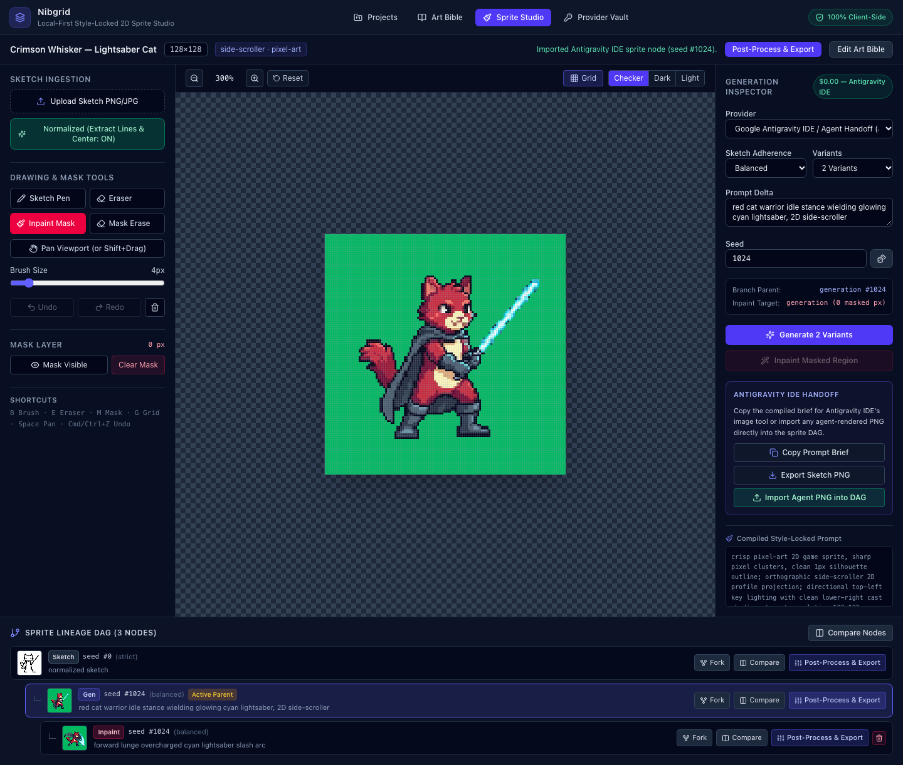

# Nibgrid

Local-first, zero-server Bring-Your-Own-Key / Bring-Your-Own-Model (BYOK/BYOM) Progressive Web App for turning hand-drawn sketches into style-locked 2D game sprites.

**Live App (GitHub Pages):** https://franekjemiolo.github.io/nibgrid/

## Architecture Summary

- **100% Client-Side & Zero-Cost Static PWA:** Runs entirely in the browser with no backend server, deployable cleanly to GitHub Pages under a configurable base path (`VITE_BASE_PATH=/nibgrid/`).
- **Art Bible Style Lock & Branching DAG Studio:** Persists projects, color palettes (`.gpl` / `.hex`), Golden Style References, sketch/inpaint masks, and non-destructive sprite lineage DAG nodes in local IndexedDB (`Dexie.js`) validated by `Zod`.
- **Google Antigravity IDE / Agent Integration & Loopback Bridge:** Select **Google Antigravity IDE / Agent Handoff** (`antigravity-agent`) for Markdown briefs and PNG DAG import, or pair the GitHub Pages PWA with the local **Antigravity Loopback Bridge** (`127.0.0.1:4188`, `antigravity-bridge`, [.agents/skills/nibgrid/SKILL.md](.agents/skills/nibgrid/SKILL.md), `uv run .agents/skills/nibgrid/scripts/nibgrid_bridge.py`) supporting stateful `interaction_id` chaining and Art Bible critique feedback.
- **Worker-Isolated Image Processing & Pixel-Art Foundry:** Sketch normalization, Chroma-Key cutout, De-Mixel grid detection & integer snapping (`demixel.ts`), 4-connected orphan-pixel & pepper despeckling (`orphanCleaner.ts`), OKLab light-aware `outer`/`inner` Sel-Out outlining (`selOut.ts`), OKLab palette quantization + 4×4 Bayer dithering, and `asset.recipe.json` + `.zip` packaging execute purely on-device.
- **WebGL2 2D Normal Maps & MLS Puppet-Warp Animator (Screens 4B & 4C):** Bake Godot/OpenGL (`+Y`) or DirectX (`-Y`) `_n.png` normal maps using exact Felzenszwalb–Huttenlocher EDT bevels with live cursor Blinn-Phong point lighting (`NormalMapPreview.tsx`), and rig control pins with Rigid/Similarity Moving Least Squares deformation (`mlsWarp.ts`, `PuppetWarpEditor.tsx`) to bake seamless idle, sway, recoil, and squash strips.
- **Seamless Tile, 9-Slice UI Panel & Palette-Swap LUT Workshops (Screens 4D & 4E):** Heal tiling textures via toroidal 50% wrap-offset, wavy center cross-seam auto-masking, and DAG inpainting with `gl.REPEAT` toroidal normal maps (`seamlessTile.ts`); slice UI frames with pixel-exact corners, auto-detected margins, live stress-test previews, and Godot `StyleBoxTexture` `.tres` / Phaser 3 / PixiJS v8 exports (`nineSlice.ts`, `nineSliceExporters.ts`); and pack lossless 8-bit indexed sprites with OKLCH palette-swap 1D/stacked LUTs + `.gdshader` / PixiJS v8 filters (`paletteLut.ts`, `lutShaders.ts`).
- **1× Game Scale Sandbox (Screen 4F):** Audition sprites, M9 Puppet-Warp loops, and M12 Palette-Swap LUT variants at exact integer `1×`–`4×` game scale over scrolling procedural biomes (`sandboxBiomes.ts`) with pure Canvas2D zero-allocation rendering (`sandboxEngine.ts`), live Rec.709 perimeter contrast telemetry (`sandboxContrast.ts`), `Normal` / `Value Check` / `Silhouette` lenses, and `40ms` hitstop + `110ms` hit-flash combat juice.
- **2D Collision Hulls, Hitbox/Hurtbox Editor & Physics Exporters (Screen 4G):** Trace sprite alpha channels via zero-padded integer half-pixel Marching Squares (`collisionHull.ts`) with closed-loop Ramer-Douglas-Peucker simplification, Andrew's Monotone Chain convex hulls, 8-vertex Box2D caps, and tight capsules anchored to exact `pivotPx`; edit semantic **Collider** / **Hurtbox** / **Hitbox** polygons interactively across M9 animation frames (`ColliderEditor.tsx`); and bundle Godot 4 `.tres` (`ConvexPolygonShape2D` / `CapsuleShape2D`), Phaser 3 / Matter.js PhysicsEditor JSON (`colliderExporters.ts`), and combined `atlas_physics.json` into sprite and atlas ZIP exports.
- **Google-First Client-Side Audio Foundry (Screen 6):** Synthesize deterministic 3-layer procedural foley (`proceduralSynth.ts`) or orchestrate Lyria 3/3.5 (`lyria-clip`/`lyria-full`), Gemini 3.8 TTS (`gemini-tts`), and Gemini JSON Sprite-to-SFX (`gemini-to-synth`) via Provider Vault's single Gemini key (`googleAudioProvider.ts`), run Worker-isolated silence trim, LUFS normalization, seamless loop crossfade, and 1/4/6 variation batching (`pcmPostProcess.ts`, `variations.ts`, `audio.worker.ts`), export WAV16 + `.audio.recipe.json` ZIPs, and bind clips straight into Screen 4F Sandbox hits/frames and Screen 4D 9-Slice button clicks.
- **Hum-to-Sound Audio Sketching (Screen 6 · Mic Sketch):** Record up to 10s of raw hums or mouth foley via a subpath-safe inline `Blob`-URL `AudioWorklet` (`micRecorder.ts`) or upload `.wav` sketches, inspect the pure-TS McLeod NSDF `f0(t)` pitch/amplitude ribbon & amber unvoiced markers (`vocalAnalyzer.ts`, `PitchRibbonCanvas.tsx`), synthesize `$0.00` contour-following variations with real-time octave/smoothing/scale/FM/breath controls (`contourSynth.ts`, `MicSketchPanel.tsx`), or route single-key Gemini Timbre (`hum-to-timbre`), BPM/key-locked Lyria 3 (`hum-to-lyria`), and cadence-matched Gemini 3.8 TTS (`hum-to-tts`, `humToSoundProvider.ts`) with full `audioSketch` recipe provenance.
- **Animated GIF89a, Horizontal Spritesheet & Multi-Engine Atlas Packer (Screen 5):** Sequence DAG sprites into transparent GIF89a animations (`gif.ts`), or pack sprites and Puppet-Warp loops via BSSF MaxRects (`maxRects.ts`, `AtlasWorkshop.tsx`) with frame deduplication, edge extrusion, lockstep `_n.png` normal atlases, and native Godot 4 `.tres`, Phaser 3 Multiatlas JSON, and PixiJS v8 exports.
- **Project-Wide Asset Audit Matrix & 1-Click Deterministic Batch Recipe Runner (Screen 7):** Audit every sprite and audio asset in IndexedDB (`projectAudit.ts`, `AuditMatrixView.tsx`) against Art Bible palette lock, 1× mixel density, dynamic target-biome contrast, M16 collider coverage, M14 category LUFS loudness + leading silence, and `recipeArtBibleHash` freshness; compute a `0–100` Readiness Score; and run `$0.00 local compute` deterministic batch fixes (`batchRunner.ts`, `BatchRunnerDrawer.tsx`) with dry-run previews, atomic Dexie transactions, mid-run cancellation, and 1-click session rollback + orphan blob garbage collection.

## Demo Walkthrough: 2D Platformer Red Cat Warrior with Lightsaber

The walkthrough below was executed end-to-end inside Nibgrid on [https://franekjemiolo.github.io/nibgrid/](https://franekjemiolo.github.io/nibgrid/) using the **Google Antigravity IDE / Agent Handoff** adapter (`antigravity-agent`) and `window.__NIBGRID_AGENT_BRIDGE__`:

### 1. Art Bible Style Lock (`Side-Scroller` · `Pixel Art`)
Lock camera projection (`Side-Scroller`), key lighting (`Top-Left`), `128×128` target resolution, a 9-color crimson cat & cyan plasma lightsaber palette, cutout-safe negative prompts, and a Golden Style Reference image in IndexedDB.


### 2. Sketch Ingestion & Web Worker Normalization
Upload a rough hand-drawn sketch (`Upload Sketch PNG/JPG`) and toggle **Extract Lines & Center** to run adaptive local/global thresholding and safe-margin bounding-box centering inside a Dedicated Web Worker.


### 3. Antigravity IDE Generation & Branching Sprite DAG
Select **Google Antigravity IDE / Agent Handoff** in the Generation Inspector to copy the compiled Markdown brief, generate style-locked sprite poses using Antigravity's image tooling (`image-generator`), and import them directly into the branching **Sprite Lineage DAG** (creating an idle combat stance, a mid-charge ignited flare fork, and a masked forward-lunge lightsaber slash child node).



### 4. Side-by-Side Variant & Inpaint Comparison
Compare sibling or ancestor/child iterations in **Side-by-Side Sprite Comparison** (Mid-Charge Ignited Flare vs. Overcharged Lightsaber Slash Arc).


### 5. Deterministic Cutout, OKLab Palette Snap, Platformer Pivot & Export
Inspect and finalize the sprite in **Post-Process & Export Inspector** with **Fast Color-Key (Flood Fill)** (`Tolerance: 12`), **Interior-RGB Defringe**, **OKLab Palette Snap** (9 Art Bible colors), **`64×64` Nearest-Neighbor** resampling, and **`Bottom-Center`** pivot (`0.50, 1.00` → `(32, 64) px`) before exporting the reproducible PNG + `asset.recipe.json` ZIP bundle.


**Exported `64×64` Game-Ready Platformer Sprite (`crimson-whisker-lightsaber-cat-generation-1024.png`):**


### 6. Animated GIF89a & Horizontal Spritesheet Export
Open **Animate & GIF** (`Animation & GIF Studio`) from the Sprite Lineage DAG dock to sequence frames (`#1 Idle Stance` → `#2 Mid-Charge Ignited Flare` → `#3 Overcharged Cyan Slash Arc`), configure **`64×64`**, **`6 FPS`**, **Ping-Pong Loop** (`4 loop steps`), **Auto Color-Key Cutout**, and **OKLab Palette Snap**, preview live playback, and download both a transparent looping GIF89a (`3.2 KB`) and a `192×64` horizontal PNG spritesheet.


**Exported `64×64` Looping Animated `.GIF` & `192×64` Horizontal Spritesheet:**


## Development

```bash
npm install
npm run dev
```

## Verification

```bash
npm run typecheck
npm run lint
npm run format:check
npm run test:unit
npm run test:e2e
python3 -m unittest tests/unit/test_nibgrid_bridge.py -v
npm run build
VITE_BASE_PATH=/nibgrid/ npm run build
```

## Browser Compatibility & Runtime Notes

- **Local Folder Export (File System Access API):** One-click folder export (`Export to Local Folder` writing `<slug>.png` and `<slug>.recipe.json`) uses `window.showDirectoryPicker`, which is natively supported in Chromium browsers (Chrome, Edge, Brave). Browsers without File System Access API support (Firefox, Safari) automatically hide/fallback to deterministic client-side `.zip` bundle download via `Download ZIP`.
- **Local AI Background Cutout (`@huggingface/transformers`):** Runs asynchronously inside a Dedicated Web Worker (`src/workers/postprocess.worker.ts`), preferring WebGPU when available and automatically falling back to single-threaded WebAssembly (`env.backends.onnx.wasm.numThreads = 1`). No `Cross-Origin-Embedder-Policy: require-corp` header is emitted, ensuring direct browser BYOK `fetch()` calls to Gemini API and local ComfyUI servers are never blocked.
- **Zero-Server Credential Isolation:** API keys saved in Provider Vault remain exclusively inside browser-local IndexedDB, are automatically redacted from error banners/diagnostics, and are never serialized into `asset.recipe.json` exports.

See [docs/VISION.md](docs/VISION.md), [docs/ARCHITECTURE.md](docs/ARCHITECTURE.md), and [JOURNAL.md](JOURNAL.md) for product thesis, architecture contracts, and milestone engineering logs.
