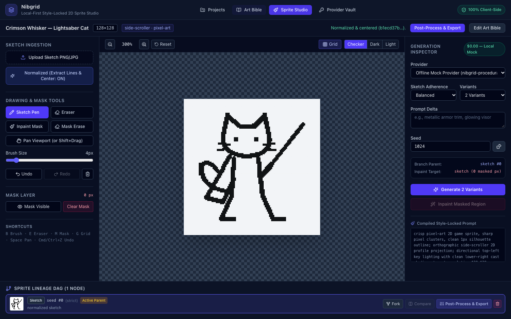
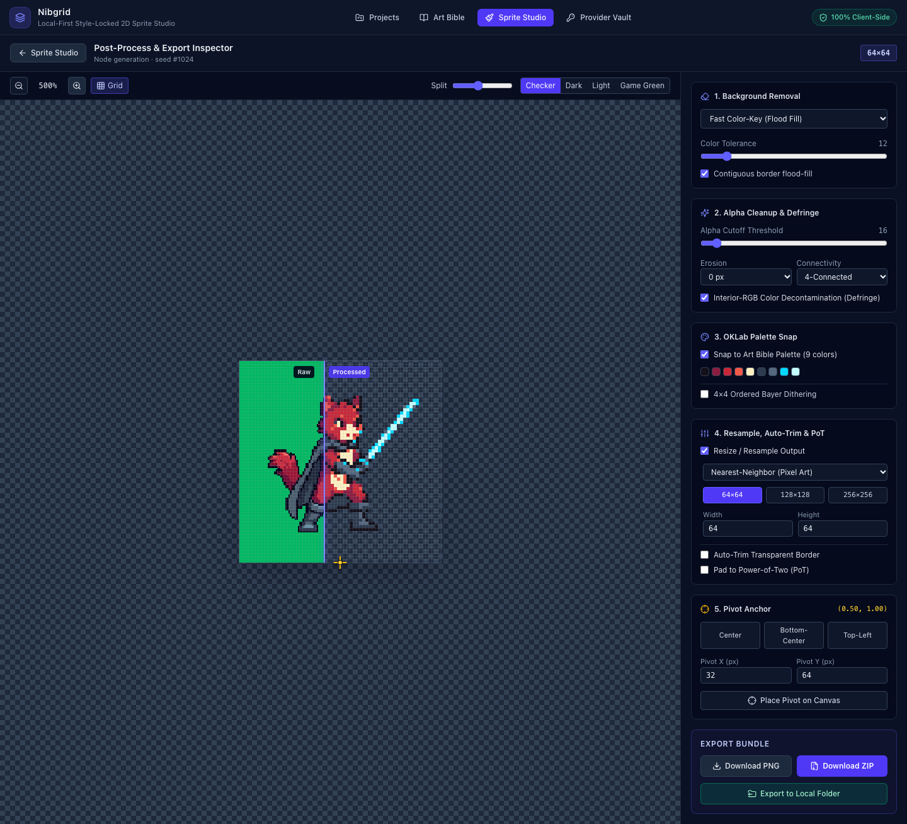
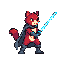

# Nibgrid

Local-first, zero-server Bring-Your-Own-Key / Bring-Your-Own-Model (BYOK/BYOM) Progressive Web App for turning hand-drawn sketches into style-locked 2D game sprites.

**Live App (GitHub Pages):** https://franekjemiolo.github.io/nibgrid/

## Architecture Summary

- **100% Client-Side & Zero-Cost Static PWA:** Runs entirely in the browser with no backend server, deployable cleanly to GitHub Pages under a configurable base path (`VITE_BASE_PATH=/nibgrid/`).
- **Art Bible Style Lock & Branching DAG Studio:** Persists projects, color palettes (`.gpl` / `.hex`), Golden Style References, sketch/inpaint masks, and non-destructive sprite lineage DAG nodes in local IndexedDB (`Dexie.js`) validated by `Zod`.
- **Google Antigravity IDE / Agent Integration:** Select **Google Antigravity IDE / Agent Handoff** (`antigravity-agent`) in Sprite Studio to copy style-locked Markdown briefs, export sketch PNGs, or import agent-generated PNG sprites into the DAG via the UI or `window.__NIBGRID_AGENT_BRIDGE__`. Includes [AGENTS.md](AGENTS.md), [GEMINI.md](GEMINI.md), and the workspace skill in [.agents/skills/nibgrid-agent-workflow/SKILL.md](.agents/skills/nibgrid-agent-workflow/SKILL.md).
- **Worker-Isolated Image Processing & Export:** Sketch normalization, Chroma-Key cutout, interior-RGB defringing, OKLab palette quantization + 4×4 Bayer dithering, Nearest-Neighbor / Area-Average resampling, auto-trim, PoT padding, and `asset.recipe.json` + `.zip` packaging execute purely on-device.

## Demo Walkthrough: 2D Platformer Red Cat Warrior with Lightsaber

The walkthrough below was executed end-to-end inside Nibgrid on [https://franekjemiolo.github.io/nibgrid/](https://franekjemiolo.github.io/nibgrid/) using the **Google Antigravity IDE / Agent Handoff** adapter (`antigravity-agent`) and `window.__NIBGRID_AGENT_BRIDGE__`:

### 1. Art Bible Style Lock (`Side-Scroller` · `Pixel Art`)
Lock camera projection (`Side-Scroller`), key lighting (`Top-Left`), `128×128` target resolution, a 9-color crimson cat & cyan plasma lightsaber palette, cutout-safe negative prompts, and a Golden Style Reference image in IndexedDB.


### 2. Sketch Ingestion & Web Worker Normalization
Upload a rough hand-drawn sketch (`Upload Sketch PNG/JPG`) and toggle **Extract Lines & Center** to run adaptive local/global thresholding and safe-margin bounding-box centering inside a Dedicated Web Worker.



### 3. Antigravity IDE Generation & Branching Sprite DAG
Select **Google Antigravity IDE / Agent Handoff** in the Generation Inspector to copy the compiled Markdown brief, generate style-locked sprite poses using Antigravity's image tooling (`image-generator`), and import them directly into the branching **Sprite Lineage DAG** (creating both an idle combat stance root generation and a masked forward-lunge lightsaber slash child node).


### 4. Side-by-Side Variant & Inpaint Comparison
Compare sibling or ancestor/child iterations in **Side-by-Side Sprite Comparison** (Idle Stance vs. Overcharged Lightsaber Slash Arc).


### 5. Deterministic Cutout, OKLab Palette Snap, Platformer Pivot & Export
Inspect and finalize the sprite in **Post-Process & Export Inspector** with **Fast Color-Key (Flood Fill)** (`Tolerance: 12`), **Interior-RGB Defringe**, **OKLab Palette Snap** (9 Art Bible colors), **`64×64` Nearest-Neighbor** resampling, and **`Bottom-Center`** pivot (`0.50, 1.00` → `(32, 64) px`) before exporting the reproducible PNG + `asset.recipe.json` ZIP bundle.



**Exported `64×64` Game-Ready Platformer Sprite (`crimson-whisker-lightsaber-cat-generation-1024.png`):**



## Development

```bash
npm install
npm run dev
```

## Verification

```bash
npm run typecheck
npm run lint
npm run format:check
npm run test:unit
npm run test:e2e
npm run build
VITE_BASE_PATH=/nibgrid/ npm run build
```

## Browser Compatibility & Runtime Notes

- **Local Folder Export (File System Access API):** One-click folder export (`Export to Local Folder` writing `<slug>.png` and `<slug>.recipe.json`) uses `window.showDirectoryPicker`, which is natively supported in Chromium browsers (Chrome, Edge, Brave). Browsers without File System Access API support (Firefox, Safari) automatically hide/fallback to deterministic client-side `.zip` bundle download via `Download ZIP`.
- **Local AI Background Cutout (`@huggingface/transformers`):** Runs asynchronously inside a Dedicated Web Worker (`src/workers/postprocess.worker.ts`), preferring WebGPU when available and automatically falling back to single-threaded WebAssembly (`env.backends.onnx.wasm.numThreads = 1`). No `Cross-Origin-Embedder-Policy: require-corp` header is emitted, ensuring direct browser BYOK `fetch()` calls to Gemini API and local ComfyUI servers are never blocked.
- **Zero-Server Credential Isolation:** API keys saved in Provider Vault remain exclusively inside browser-local IndexedDB, are automatically redacted from error banners/diagnostics, and are never serialized into `asset.recipe.json` exports.

See [docs/VISION.md](docs/VISION.md), [docs/ARCHITECTURE.md](docs/ARCHITECTURE.md), and [JOURNAL.md](JOURNAL.md) for product thesis, architecture contracts, and milestone engineering logs.
