# Zero-to-Godot Game Tutorial: *Crimson Whisker: Lunar Starbase*

Build an entire playable **2D sci-fi platformer** in **Nibgrid + Godot 4.3+** — starring a **red cat hero wielding a glowing cyan lightsaber** fighting rogue security drones and riot robots across a **star base on a remote moon**.

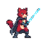


Every screenshot below was captured directly from Nibgrid (`1440×900` `@2x`) using the built-in **`$0.00` Local/Offline Engine** — zero backend servers and zero mandatory API keys. If you connect a single **Gemini** key in **Provider Vault** (or run the local **Antigravity Bridge** / **ComfyUI**), every prompt also generates full AI artwork and adaptive audio with identical workflows.

---

## Table of Contents

- [Before You Start (2 Minutes)](#before-you-start-2-minutes)
- [Step 1 — Generate the Starbase Spine in Director Studio (`1. Style & Vision`)](#step-1--generate-the-starbase-spine-in-director-studio-1-style--vision)
- [Step 2 — Pin the Red Cat Golden Reference in Art Bible](#step-2--pin-the-red-cat-golden-reference-in-art-bible)
- [Step 3 — Assemble Your Hero in Sprite Studio (`Auto-Assemble Entity`)](#step-3--assemble-your-hero-in-sprite-studio-auto-assemble-entity)
- [Step 4 — Feel-Test Movement, Hitstop & Combat in Entity Hub (`▶ Playtest`)](#step-4--feel-test-movement-hitstop--combat-in-entity-hub--playtest)
- [Step 5 — Add a Rogue Turret Bot & Airlock Alert via Asset Composer (`Cmd+L`)](#step-5--add-a-rogue-turret-bot--airlock-alert-via-asset-composer-cmdl)
- [Step 6 — Audit Multi-Room Lunar Starbase Flow & Bake the Minimap](#step-6--audit-multi-room-lunar-starbase-flow--bake-the-minimap)
- [Step 7 — Tune the Plasma Lightsaber in Data Foundry & Balance Lab](#step-7--tune-the-plasma-lightsaber-in-data-foundry--balance-lab)
- [Step 8 — Write Starbase Story Briefings & Audit Font Glyphs](#step-8--write-starbase-story-briefings--audit-font-glyphs)
- [Step 9 — Synthesize 4× Lightsaber Slash SFX in Audio Foundry](#step-9--synthesize-4-lightsaber-slash-sfx-in-audio-foundry)
- [Step 10 — Auto-Heal Pre-Flight QA & Ship the F5 Godot 4 GameKit](#step-10--auto-heal-pre-flight-qa--ship-the-f5-godot-4-gamekit)
- [Step 11 — Open in Godot 4.3+, Customize Gameplay & Export for Release](#step-11--open-in-godot-43-customize-gameplay--export-for-release)
- [Regenerating These Screenshots](#regenerating-these-screenshots)

---

## Before You Start (2 Minutes)

1. Open Nibgrid ([GitHub Pages PWA](https://franekjemiolo.github.io/nibgrid/) in Chromium for live `res://` folder sync, or any browser for ZIP downloads — or run **Nibgrid Studio** inside VS Code).
2. Keep the header mode pill on **`Creator`** (default). Creator Mode surfaces high-level game creation presets and hides low-level shader/math panels until you explicitly want **`Pro`** overrides.
3. Create an empty Git-tracked folder on your computer named `crimson-whisker-godot/`.

---

## Step 1 — Generate the Starbase Spine in Director Studio (`1. Style & Vision`)

Start at the top of the guided workflow so you have an entire multi-room Godot skeleton before polishing individual sprites.

1. In **Project Hub**, enter **`Crimson Whisker: Lunar Starbase`** and click **Create Project**.
2. Click **`1. Style & Vision`** in the workspace bar (which opens **Director Studio** directly). Notice the **Game Path** progress ribbon at the top (`1. Vision & Style → 2. Cast & World → 3. Balance & L10n → 4. Pre-Flight QA → 5. Ship & Play F5`).
3. Enter the creative brief:
   > `16-bit sci-fi 2D platformer: red cat hero with blue glowing lightsaber defeating bad robots in a star base on a remote moon, steel lunar bulkhead tileset, cratered moon parallax skyline, cyan sci-fi HUD`
4. Set **Genre** → `Side-Platformer`, **Game Scope** → `3-Room Dungeon Loop`, **Execution Tier** → `Instant Draft ($0.00 Local)`.
5. Click **`Plan & Lock Style Anchor`**. Inspect the generated palette & hero anchor inside the **Style Anchor Gate**, then click **`Approve & Build Full Game`** to run all **17 reactive DAG nodes** (tileset, parallax, hero & enemy robots, bitmap HUD font, Godot `Theme`, 3 starbase rooms, `WorldGraph`, `GameDataRegistry`, `NarrativeBundle`, Self-Healing QA, and GameKit validation).

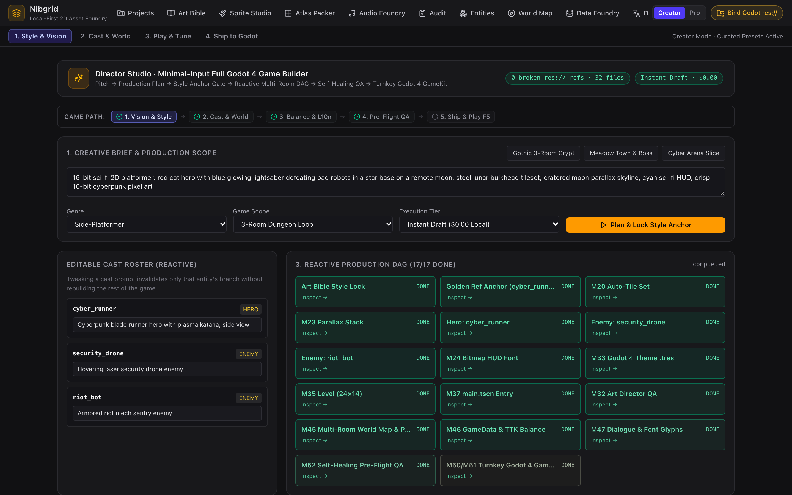

---

## Step 2 — Pin the Red Cat Golden Reference in Art Bible

Now anchor the visual identity of your star protagonist so every future sprite, tile, and batch fix obeys one cohesive palette and perspective.

1. Click **`Art Bible`** in the header navigation.
2. Confirm **Camera Projection** is `Side-Scroller`, **Key Lighting** is `Top-Left`, and **Art Mode** is `Pixel Art` (`64×64`).
3. Under **Golden References**, click **`Upload Ref`** and attach your key concept art ([`red-cat-warrior-final-64x64.png`](demo/red-cat-warrior-final-64x64.png)).
4. Review the 6 locked palette swatches (`#0F1021`, `#1F244B`, `#3B6EA5`, `#4CC9F0`, `#F72585`, `#FFE066`) matching obsidian space bulkheads and cyan plasma.

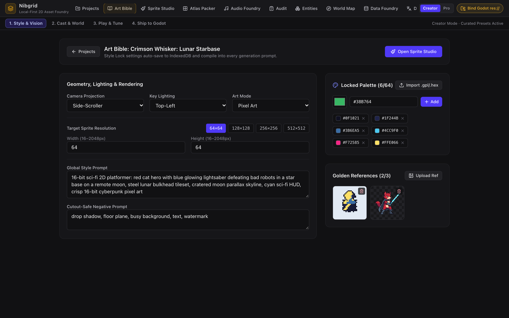

---

## Step 3 — Assemble Your Hero in Sprite Studio (`Auto-Assemble Entity`)

Instead of wiring normal maps, collision polygons, sockets, shaders, SFX, and `.tscn` files manually across seven tabs, assemble your Red Cat Hero in one click.

1. Click **`Sprite Studio`** in the header.
2. Click **`Upload Sketch PNG/JPG`** and upload your Red Cat concept or rough line sketch.
3. Under **Generation Inspector**, type a focused **Prompt Delta**:
   > `red cat hero wielding glowing cyan plasma lightsaber in lunar starbase`
4. Click **`Generate 2 Variants`** (or **`Inpaint Masked Region`** / toggle **`Auto-Polish`** if refining details).
5. With your chosen generation node active, click **`Auto-Assemble Entity`** in the top-right action bar. In one atomic transaction, Nibgrid runs Cutout, Palette Lock, Sobel Normal & Emissive baking (`_n.png` / `_e.png`), M16 convex hull collision tracing, M21 attachment sockets, M27 canvas shader wiring, M14 SFX generation, and a typed `.tscn` prefab.

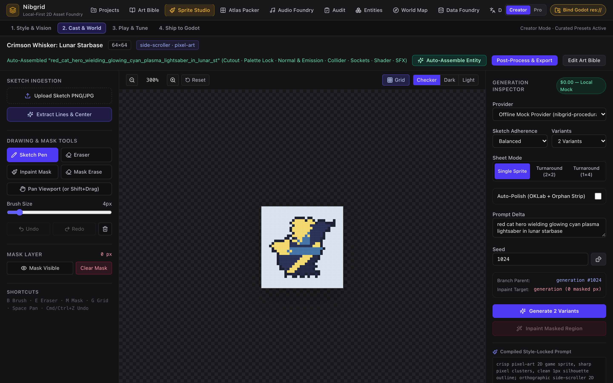

---

## Step 4 — Feel-Test Movement, Hitstop & Combat in Entity Hub (`▶ Playtest`)

Dial in platformer kinematics and combat impact before ever launching Godot.

1. Click **`Entities`** to open **Entity Hub & Godot 4 Prefab Foundry** (`red_cat_hero`, `security_drone`, `riot_bot`, and `cyber_runner`).
2. Click **`▶ Playtest`** on your hero card to open the **60 Hz Mini-Playtest Stage**.
3. Use `WASD`/`Arrows` to move, `W`/`K` to jump, and `Space`/`J` to swing your lightsaber against the test dummy (`H` toggles M16 collision hulls and M21 weapon/foot sockets).
4. Adjust **Move Speed** (`140 px/s`), **Gravity** (`780`), **Hitstop** (`55 ms`), **Screen Shake** (`5 px`), and **Knockback** (`110 px`), then click **`Apply Stats to Entity .gd`** to write the updated `@export` values straight into Godot exports.

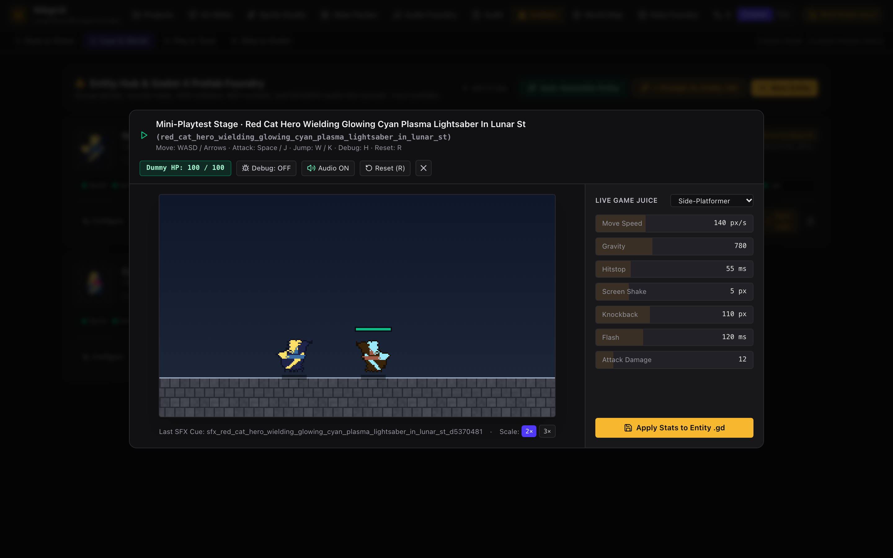

---

## Step 5 — Add a Rogue Turret Bot & Airlock Alert via Asset Composer (`Cmd+L`)

Add new enemies, scripted events, and QA repairs across your whole project in a single conversational turn with full rollback safety.

1. Press **`Cmd/Ctrl+L`** (or click **`Composer`** in the header) to open **Asset Composer**.
2. Enter a multi-tool Director instruction:
   > `create enemy laser_turret_bot and add dialogue node airlock_alert "Red alert! Rogue robots breached the lunar airlock!" and autofix preflight`
3. Click **`Plan & Stage Visual Diff`**. Inspect each staged card (`create_entity_from_prompt`, `author_dialogue_node`, `run_preflight_autofix`) before mutating IndexedDB.
4. Click **`Accept All & Checkpoint`** so Nibgrid saves a 1-click Dexie rollback snapshot alongside the new assets.

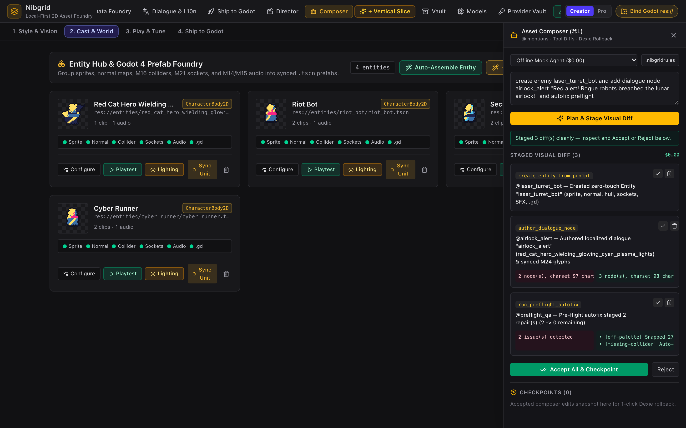

---

## Step 6 — Audit Multi-Room Lunar Starbase Flow & Bake the Minimap

Make sure players can traverse from the airlock landing bay through the reactor corridor into the robot boss hangar without dead ends.

1. Click **`World Map`** in the header.
2. Inspect the connected rooms (`START` -> `Dungeon Entry` -> `Boss Hall` `GOAL`) and use **Portal Transitions** or **Grants Flags / Keys** if adding locked security keycards (e.g., `airlock_key`).
3. Click **`Run Softlock Audit`** to verify Progression BFS and confirm zero one-way trap rooms (`SOFTLOCK AUDIT OK`).
4. Click **`Bake Minimap & Save`** to generate the palette-locked `world/minimap.png` and `minimap_atlas.json` HUD overlay.

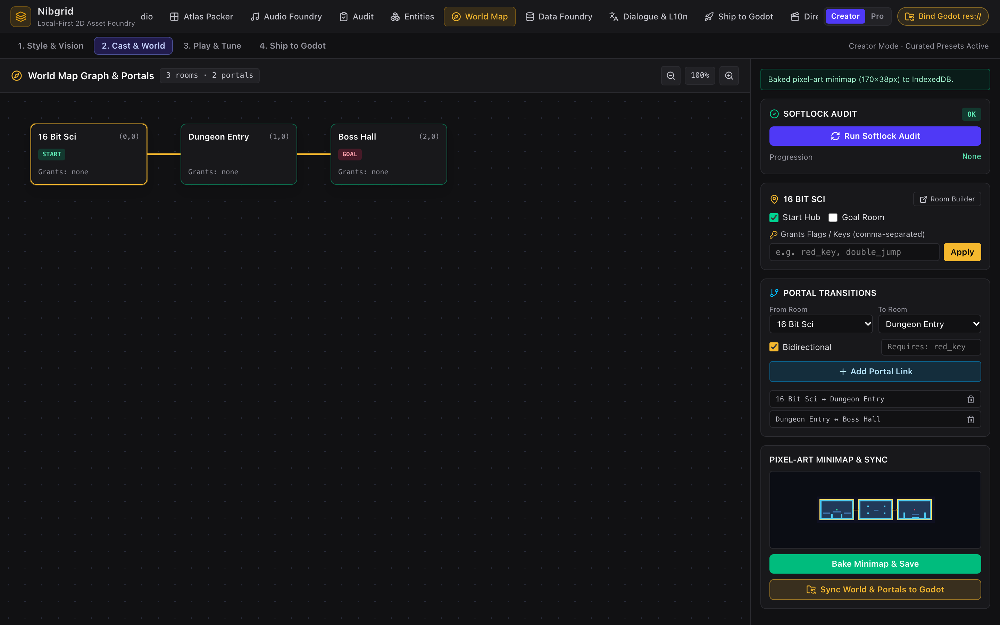

---

## Step 7 — Tune the Plasma Lightsaber in Data Foundry & Balance Lab

Balance your hero's weapon damage curves against lunar security bots before shipping scenes.

1. Click **`Data Foundry`** in the header (`3. Play & Tune`).
2. Add a custom weapon on the **Items** tab:
   - ID: `plasma_lightsaber` · Name: `Plasma Lightsaber` · Damage: `38` · Attacks/Sec: `1.8` -> click **`+ Add Weapon`**.
3. On the right **Monte Carlo Balance Lab** sidebar, select `Plasma Lightsaber` vs. `Security Drone`, leave Seed `42` and `1000` runs, and click **`Run Monte Carlo TTK Sim`**.
4. Confirm clean combat pacing (`P50 TTK 1.11s`, `Eff. DPS 78.5`, `Win Rate 100.0%`), click **`Push to M36 Playtest`** if syncing back to Entity Hub, and keep exported `data/schemas/*.gd` + `data/items/*.tres` in sync.

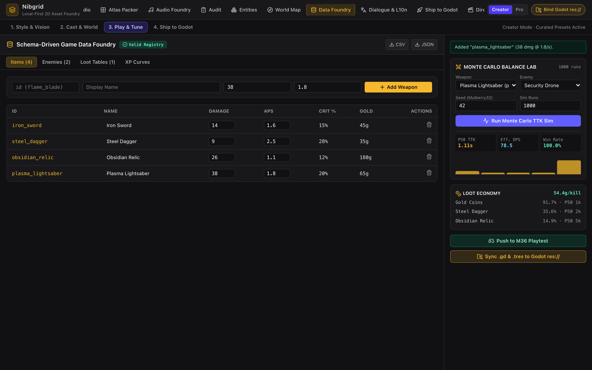

---

## Step 8 — Write Starbase Story Briefings & Audit Font Glyphs

Author localized sci-fi comms without missing glyphs or clipped dialogue boxes at 16-bit pixel resolution.

1. Click **`Dialogue & L10n`** in the header.
2. Under **Add Branching Node**, create a mission briefing:
   - Node ID: `moon_base_briefing` · Key: `DLG_LUNAR_BRIEF_01`
   - `EN`: `Commander Whisker, rogue droids seized Lunar Sector 7!`
   - `PL`: `Komandorze, zbuntowane roboty przejęły Sektor 7!`
   - `DE`: `Kommandant, abtrünnige Roboter haben Sektor 7 besetzt!`
3. Click **`+ Add Branching Node & Strings`**. Look at the **M24 Bitmap Font Glyph Audit** card: Nibgrid immediately flags non-ASCII diacritics (`ę`, `ł`, `ü`) missing from the default bitmap font charset — ready for 1-click remediation next!

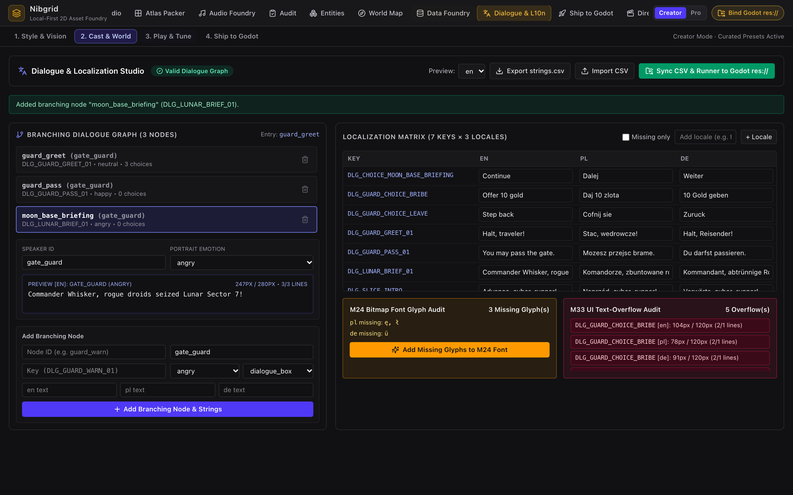

---

## Step 9 — Synthesize 4× Lightsaber Slash SFX in Audio Foundry

Give every lightsaber swing four subtle acoustic variations so melee combat never sounds repetitive.

1. Click **`Audio Foundry`** in the header.
2. Keep **Generation Route** on `Local Procedural Synth ($0.00)` (or choose Gemini/Lyria with your key), click **`Render Local Synth ($0.00)`**, and tweak the **3-Layer Synth Patch** (`Body Start Hz`, `Transient Attack Gain`, `Noise Tail Gain`).
3. On the right **PCM Post-Processor**, confirm **LUFS Loudness Normalize** is set to `-14 LUFS (SFX / Impacts)`, click **`4×`** under **Anti-Repetition Variations**, name the clip `lightsaber_slash`, and click **`Save to Project (4 WAV)`**.

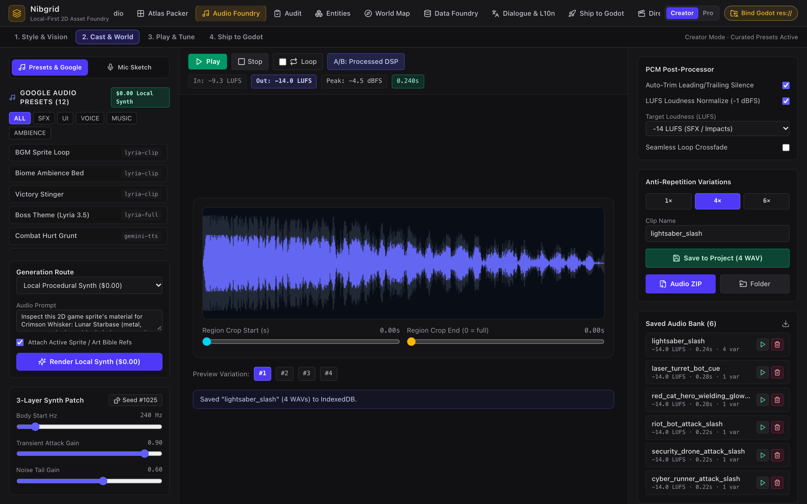

---

## Step 10 — Auto-Heal Pre-Flight QA & Ship the F5 Godot 4 GameKit

Finish by resolving every remaining project drift and compiling a verified `res://` tree.

1. Click **`Ship to Godot`** (`4. Ship to Godot`).
2. Click **`Auto-Heal Pre-Flight`** so Nibgrid deterministically repairs those missing Polish/German bitmap font glyphs (notice `Self-Healed 1 issue(s) (before: 1 -> after: 0 unresolved)`), off-palette pixels, and any world traps in one pass.
3. Confirm **`0 broken res:// refs · 146 files`** in the top badge.
4. Keep **`Side-Platformer GameKit`** selected and **`Preserve User Scaffolds`** checked.
5. Click **`Sync Turnkey GameKit + Plugin to res://`** and select your `crimson-whisker-godot/` folder (or click **`Download ZIP`** in non-Chromium browsers).

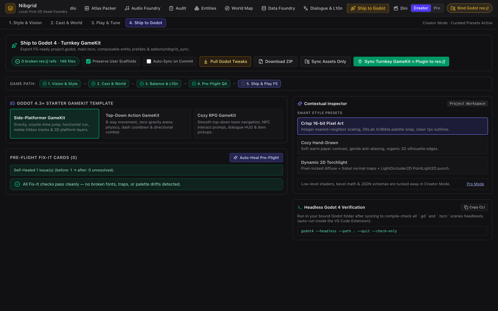

---

## Step 11 — Open in Godot 4.3+, Customize Gameplay & Export for Release

1. Open `crimson-whisker-godot/project.godot` in **Godot 4.3+** and press **F5**.
   - **Title Screen** (`Start Game`) -> **Active Level** with `Camera2D` -> **HUD** (`HpBar`, `MinimapPanel`, `DialogueBox`) -> **Pause Menu** (`Resume`, `Save Progress` via `SaveManager.gd`) -> **Game Over** (`Restart Room`) are all pre-wired in `scripts/GameShell.gd`.
   - Hero controls (`A`/`D` or arrows, `Space` jump with coyote time, `Z` lightsaber attack, `E` NPC interact) run via `scripts/runtime/PlayerController.gd`, and enemy patrols/chase/damage run via `scripts/runtime/EnemyAiController.gd`.
   - Inside Godot's `Project -> Project Settings -> Plugins`, `Nibgrid Live Sync` (`addons/nibgrid_sync/nibgrid_sync.gd`) automatically scans new `res://` files whenever you re-sync.
2. **Iterate safely between Godot and Nibgrid:**
   - Tweaked `move_speed` or other stats in Godot's Inspector? Click **`Push Tweaks to Nibgrid`** in the Inspector (writing `.nibgrid_sync_delta.json`), then click **`Pull Godot Tweaks`** in Nibgrid's **Ship to Godot** bar.
   - Re-added sprites, enemies, rooms, or localized lines in Nibgrid? Click **`Sync Turnkey GameKit + Plugin to res://`** with **`Preserve User Scaffolds`** checked — Nibgrid updates `nibgrid-managed` assets without overwriting your edits to `project.godot`, `main.tscn`, `scripts/GameShell.gd`, or `scripts/runtime/*`.
   - Validate scripts headlessly from your project folder:
     ```sh
     godot4 --headless --path . --quit --check-only
     ```
3. **Final release polish inside Godot:** Add custom boss phases in `game/bosses/`, wire a Godot Options/Audio bus slider panel, configure `Project -> Export...` presets (macOS/Windows/Linux/Web), and build your final distributable!

---

## Regenerating These Screenshots

```sh
VITE_BASE_PATH=/nibgrid/ npm run build
VITE_BASE_PATH=/nibgrid/ npx vite preview --host 127.0.0.1 --port 4173 --strictPort &
SHOT_URL=http://127.0.0.1:4173/nibgrid/ node scripts/capture-tutorial-screenshots.mjs
```
